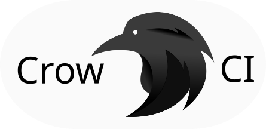

  

# Blacksmith CI

A hardened fork of [Crow CI](https://codeberg.org/crowci/crow) (itself a fork of
Woodpecker CI) maintained by Quad4. Container-native CI for Blacksmith and
Forgejo forges.

## Components

- `crow-server` - central orchestration hub, API gateway and web UI
- `crow-agent` - pipeline execution worker, connects to the server over gRPC
- `crow` - CLI for administration, operations and local pipeline runs

Binary names, module paths and `CROW_*` environment variables are kept
compatible with upstream Crow CI.

## Build

Requires Go, Node or Bun, and [just](https://github.com/casey/just).

    just build-server   # server binary, includes the UI build
    just build-agent    # agent binary
    just build-cli      # CLI binary
    just build-ui       # web UI only

Artifacts land in `dist/`.

## Test

    just test           # all tests
    just test-server    # server tests with coverage
    just lint-backend   # Go linter
    just lint-frontend  # frontend linter

## Documentation

Upstream user and admin documentation lives at
[docs.crowci.com](https://docs.crowci.com). The docs source in `docs/` still
describes upstream Crow CI and will be rebranded separately.

## License

Apache License 2.0, same as upstream. See `LICENSE`.
