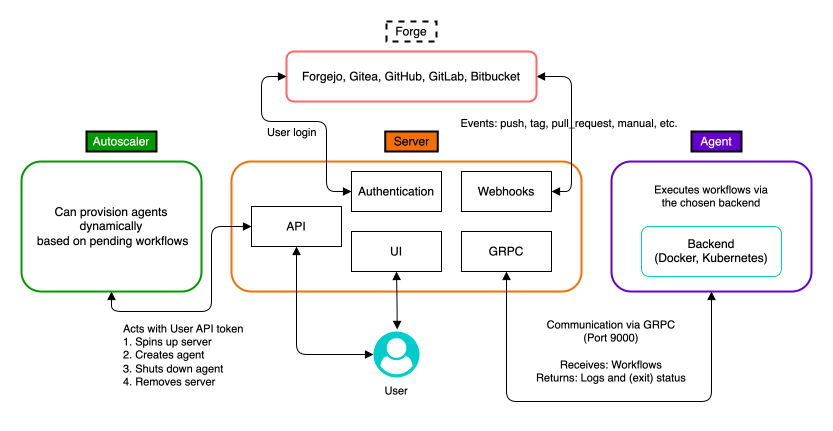

---
hide:
  - toc
---

<!-- markdownlint-disable MD041 -->
# Configuration

All configuration is done through via environment variables.
These pages describe the configuration of **Server**, **Agent** and the _optional_ **Autoscaler** in greater detail.

A list of all existing environment variables is available at ["All environment variables"](env-vars.md).

{ width="800" }
/// caption
Architectural overview of Crow CI components
///
