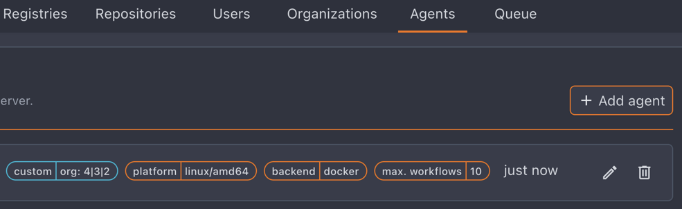

Agent configuration for Crow CI workers.

## Minimum Configuration

```yaml
CROW_SERVER=crow-server:9000
CROW_AGENT_SECRET=<token>
```

| Variable            | Description                              |
| ------------------- | ---------------------------------------- |
| `CROW_SERVER`       | Server gRPC address (no protocol prefix) |
| `CROW_AGENT_SECRET` | Authentication token from server         |

## Parallel Workflows

```yaml
CROW_MAX_WORKFLOWS=4
```

By default, agents execute one workflow at a time. Increase based on available resources.

:::note
A pipeline often consists of multiple workflows. Match this setting to your environment's capacity.
:::

## Single-Use Agents

```yaml
CROW_AGENT_MAX_LIFETIME_WORKFLOWS=1
```

`CROW_MAX_WORKFLOWS` caps how many workflows an agent runs *at once*.
`CROW_AGENT_MAX_LIFETIME_WORKFLOWS` caps how many it runs *in total*: once the budget is used up the agent stops polling, waits for what it is still running, unregisters and exits with status 0.
The default of `0` keeps the usual behaviour, where an agent serves workflows until it is stopped.

This is the ephemeral-runner model: a value of `1` gives every job a machine that has never run anyone else's pipeline.
It is what a public instance needs, because an agent host is otherwise reused between workflows, and whatever a pull request from a stranger leaves behind — a poisoned build cache, a background process, a modified toolchain — is still there for the next repository's job.

:::caution
The supervisor must not restart the agent.
The point of the setting is to discard the whole machine after the job, so run it in a VM or container that is created per job and thrown away afterwards, not under a `systemd` unit with `Restart=always` or a Docker `restart: unless-stopped` policy.
:::

Details worth knowing:

- Waiting for work costs nothing: an agent that polls an empty queue for an hour still has its full budget when a workflow finally arrives.
- `CROW_MAX_WORKFLOWS` is capped at the lifetime budget, since an agent that retires after one workflow can never use more than one slot.
- A workflow adopted from a previous agent on the same machine is charged against the budget. Its containers already ran there, which is the contamination the budget is counting.

Whether the agent disappears from the server on retirement depends on how it registered:

| Registration                                                     | On retirement                                                                              |
| ---------------------------------------------------------------- | ------------------------------------------------------------------------------------------ |
| Shared secret (`CROW_AGENT_SECRET`, a system agent)               | The server deletes the agent.                                                              |
| Individual agent token, as created by the autoscaler or by an org | The server keeps the record; whoever created the agent is responsible for removing it.     |

In both cases the process stops polling and exits 0.
If the machines come from the [autoscaler](/dev/configuration/autoscaler/), pair the lifetime budget with a provider that gives each agent its own VM, and note that the autoscaler currently reclaims a retired agent only after `CROW_AGENT_IDLE_TIMEOUT` rather than as soon as it exits.

## Workflow Filtering

Crow routes workflows to agents using two mechanisms:

| Method   | Description                                            |
| -------- | ------------------------------------------------------ |
| Labels   | Filter by matching key-value pairs                     |
| Priority | Prefer agents with higher priority when multiple match |

:::caution
Label filtering takes precedence. If an agent is excluded by labels, priority has no effect.
:::

### Labels

Agents have built-in labels:

| Label      | Description                                           |
| ---------- | ----------------------------------------------------- |
| `backend`  | Execution backend (docker, kubernetes, local, podman, tart) |
| `type`     | Agent type                                            |
| `platform` | OS/architecture                                       |
| `agent`    | Agent identifier                                      |

Add custom labels to route specific workflows:

```yaml
# Agent configuration
CROW_AGENT_LABELS='gpu=true,memory=high'
```

```yaml
# Workflow configuration (.crow.yaml)
labels:
  gpu: true
  memory: high
```

Only agents with matching labels will process workflows with those labels.

### Priority

When multiple agents match, higher priority agents are preferred.
Priority is managed server-side per agent in the web UI (agent settings) or via the API, and persists across agent and server restarts.
Priority is honored in both single-instance and High Availability deployments.

### Scheduling strategy

Labels and priority narrow the set of eligible agents.
When several agents remain eligible (matching labels, tied on the highest priority), the server picks one according to the `CROW_SCHEDULING_STRATEGY` server setting:

| Strategy       | Behavior                                                                                             |
| -------------- | ---------------------------------------------------------------------------------------------------- |
| `least-loaded` | Assign to the agent with the lowest current load (running workflows relative to its slots). Default. |
| `pack`         | Concentrate work on the fewest agents by filling the busiest agent that still has a free slot first. |
| `round-robin`  | Cycle through eligible agents in a stable order, ignoring current load.                              |
| `random`       | Pick a uniformly random eligible agent.                                                              |

`least-loaded` spreads builds evenly and is the best default for even utilization.
`pack` pairs well with the [autoscaler](/dev/configuration/autoscaler): keeping idle agents empty lets them be scaled down.
An agent's number of slots is its [parallel workflow](#parallel-workflows) capacity, so load balancing scales proportionally to each agent's capacity.

## Agent Types

### Global Agents

Admin-managed agents that process all workflows. Configure via environment variables on the agent.

#### System Agents (shared secret)

Agents that authenticate with the shared `CROW_AGENT_SECRET` register as **system agents** and are labeled `System` in the admin agent list.
They share a single token, so the server identifies them by hostname.

On reconnect, a system agent re-binds to its existing row using its hostname instead of creating a new one.
This keeps a restarted agent (for example, a container without persistent `agent-config`) visible under one stable entry rather than accumulating orphaned rows.

:::note
Run at most one system agent per hostname.
Multiple agents that share the secret and hostname re-bind to the same row.
Give each its own pre-generated per-agent token (created via **Add agent**) when you need several agents on one host.
:::

Agents configured with a per-agent token always bind to their pre-created row by token, regardless of hostname.

### Organization/User Agents

Non-admin users can register agents scoped to their org or user account.

:::caution
Scoped agents can only process workflows from their assigned org/user for security isolation.
:::

**Remote agent configuration:**

```yaml
CROW_SERVER=grpc.crow.example.com:443
CROW_GRPC_SECURE=true
CROW_AGENT_SECRET=<token>
CROW_BACKEND=docker
```

:::tip
When global agents exist alongside scoped agents, add custom labels to ensure workflows route to the intended agent.
:::

### Multi-Org Agents

:::note
Admin-only feature.
This is for security reasons: otherwise it would be possible to route workflows of other users to a custom agent.
:::

Process workflows from multiple specified organizations or repositories.

```yaml
# Multiple orgs (pipe-separated)
CROW_CUSTOM_LABELS='org=1|2|3'

# Alternative syntax (comma-separated, merged internally)
CROW_CUSTOM_LABELS='org=1,org=2,org=3'

# Limit to specific repos
CROW_CUSTOM_LABELS='org=myorg,repo=myorg/specific-repo'
```

Multi-org labels appear highlighted in the agent list:



## Agent Scope

Admins choose an agent's scope in the **Add agent** dialog.
**Global** (the default) lets the agent run pipelines for any organization.
**Specific organizations** scopes the agent to one or more selected orgs.

Org admins can manage agents scoped to their organization from the org's agent settings page.
Deleting a multi-org agent there removes it from that organization only;
it is fully deleted when that was its last remaining organization.

## Reported Host Resources

Agents report the CPU core count and total memory of the machine that runs their workloads.
The agent list and the agent detail page show these totals next to the per-workflow limits, so a limit like `4 GB / 64 GB` reads as "4 GB per workflow on a 64 GB host".

The numbers describe the workload host, not the agent process.
An agent that drives a remote Docker daemon reports the daemon's machine.

| Backend    | Reported                                         |
| ---------- | ------------------------------------------------ |
| docker     | cores and memory of the Docker daemon host       |
| podman     | cores and memory of the Podman host              |
| local      | cores everywhere, memory on Linux only           |
| kubernetes | nothing, since workloads are spread across nodes |

Values are read once when the agent starts and refreshed whenever it re-registers.
Agents older than the server simply report nothing, and the totals stay hidden for them.

## Backend Options

Configure backend-specific settings at the agent level. See [environment variables](/dev/configuration/env-vars/) for all `CROW_BACKEND_*` options.

:::tip
Running agents on Windows hosts? See [Windows Agents](/dev/configuration/windows-agent) for choosing between the docker, Hyper-V and local backends, what Windows hosts cost, recommended container images, and routing caveats.
:::

### Local Backend Sandboxing

:::caution[macOS only]
Sandboxing is implemented with the macOS `sandbox-exec` utility.
On Linux and Windows it is a no-op: `CROW_BACKEND_LOCAL_SANDBOX_LEVEL` is accepted but has no effect, and pipeline commands run with the agent user's full access to the host at every level.

Before running a `local` backend agent outside macOS, read the trade-offs on [Standalone Agent Binaries](/dev/installation/binary/).
:::

Enable process isolation using macOS `sandbox-exec`:

```yaml
CROW_BACKEND_LOCAL_SANDBOX_LEVEL=standard
```

| Level      | Network    | System Access | Use Case                          |
| ---------- | ---------- | ------------- | --------------------------------- |
| `none`     | ✅ Full    | ✅ Full       | Trusted code only                 |
| `standard` | ✅ Full    | ⚠️ Limited    | Most CI/CD workloads              |
| `strict`   | ❌ Blocked | ❌ Minimal    | Offline builds, maximum isolation |

**Standard level details:**

| Allows                                              | Denies                                           |
| --------------------------------------------------- | ------------------------------------------------ |
| Network access (npm, go get, pip)                   | Another workflow's directories on the same agent |
| System libraries and frameworks                     | Writing anywhere outside the allowed directories |
| The workflow's own directories, including `$TMPDIR` | Sensitive user dirs (Documents, Desktop)         |
| Shared build caches and the account's temp dir      | SSH private keys                                 |
| Shell configs (.bashrc, .zshrc)                     | The agent's own environment and credentials      |

:::caution
`standard` hardens an agent against the pipelines it runs.
It does not partition one agent between repositories that do not trust each other: the build caches and the account's temp directory stay shared between workflows.
See [Standalone Agent Binaries](/dev/installation/binary/#standard-default) for what the profile does and does not cover.

Where repositories genuinely do not trust each other, give each job its own machine with [Single-Use Agents](#single-use-agents).
:::

:::warning
`none` runs processes without isolation. Only use with fully trusted code.
:::

:::note
`strict` blocks network access, breaking most CI/CD workflows that download dependencies.
:::
