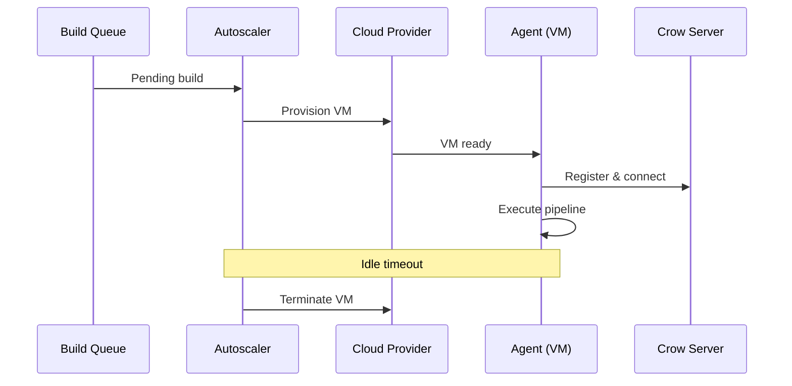

import { Steps } from '@astrojs/starlight/components';

The [Crow CI Autoscaler](https://codefloe.com/crowci/autoscaler) dynamically provisions cloud servers to execute pipelines, then terminates them when idle.



## Supported Providers

| Provider      | Configuration Reference                                                                             |
| ------------- | --------------------------------------------------------------------------------------------------- |
| AWS           | [flags.go](https://codefloe.com/crowci/autoscaler/src/branch/main/providers/aws/flags.go)           |
| Hetzner Cloud | [flags.go](https://codefloe.com/crowci/autoscaler/src/branch/main/providers/hetznercloud/flags.go)  |
| Linode        | [flags.go](https://codefloe.com/crowci/autoscaler/src/branch/main/providers/linode/flags.go)        |
| Scaleway      | [flags.go](https://codefloe.com/crowci/autoscaler/src/branch/main/providers/scaleway/flags.go)      |
| Vultr         | [flags.go](https://codefloe.com/crowci/autoscaler/src/branch/main/providers/vultr/flags.go)         |

Additional providers with a Go SDK can be added — contributions welcome!

## Setup

<Steps>

1. **Deploy alongside the server** — the autoscaler listens for build triggers

2. **Configure server connection** — provide server address and authentication tokens

3. **Configure scaling limits** — set min/max agents and workflows per agent

4. **Configure gRPC** — set the autoscaler's gRPC endpoint, and forward it to spawned agents via `CROW_AGENT_ENV`

5. **Configure cloud provider** — set provider credentials and instance settings

</Steps>

:::tip
Provisioning **Windows** VMs through the autoscaler? Set `CROW_OS_TYPE=windows`, and note that `CROW_AGENT_IMAGE` is then treated as a URL to a `crow-agent_windows_amd64.zip` artifact, not a container image. See [Windows Agents](/dev/configuration/windows-agent) for the full picture, including recommended container images for your steps.

A pool intended to run the [Hyper-V backend](/dev/configuration/env-vars/backend-hyperv/) additionally needs an instance type offering nested virtualization, which rules out most of them.
:::

## Complete Example

```yaml
# docker-compose.yaml
services:
  crow-autoscaler:
    image: codefloe.com/crowci/crow-autoscaler:<version>
    restart: always
    depends_on:
      - crow-server
    environment:
      # Server connection
      - CROW_SERVER=crow-server:9000
      - CROW_TOKEN=${CROW_TOKEN} # Admin API token
      - CROW_AUTOSCALER_TOKEN=${CROW_AUTOSCALER_TOKEN}

      # Scaling limits
      - CROW_MIN_AGENTS=0
      - CROW_MAX_AGENTS=2
      - CROW_WORKFLOWS_PER_AGENT=5

      # Autoscaler's own gRPC connection to the server
      - CROW_GRPC_ADDR=grpc.crow.example.com
      - CROW_GRPC_SECURE=true

      # Timeouts
      - CROW_AGENT_IDLE_TIMEOUT=10m
      - CROW_AGENT_SERVER_CONNECTION_TIMEOUT=10m

      # Cloud provider (Hetzner example)
      - CROW_PROVIDER=hetznercloud
      - CROW_HETZNERCLOUD_API_TOKEN=${HETZNER_TOKEN}
      - CROW_HETZNERCLOUD_LOCATION=fsn1
      - CROW_HETZNERCLOUD_SERVER_TYPE=cax41
      - CROW_HETZNERCLOUD_IMAGE=ubuntu-24.04
      - CROW_HETZNERCLOUD_NETWORKS=my-network
      - CROW_HETZNERCLOUD_SSH_KEYS=my-key
      - CROW_HETZNERCLOUD_FIREWALLS=my-firewall

      # Agent image (optional — auto-detected from server version if omitted)
      # - CROW_AGENT_IMAGE=codefloe.com/crowci/crow-agent:v5.3.2

      # Optional: agent environment
      - CROW_AGENT_ENV=CROW_LOG_LEVEL=debug,CROW_HEALTHCHECK=false
```

## Configuration Reference

### Server Connection

| Variable                | Description                             |
| ----------------------- | --------------------------------------- |
| `CROW_SERVER`           | Server address (internal or public URL) |
| `CROW_TOKEN`            | Admin API token for agent management    |
| `CROW_AUTOSCALER_TOKEN` | Registration token for autoscaler       |

### Scaling

| Variable                   | Default | Description                   |
| -------------------------- | ------- | ----------------------------- |
| `CROW_MIN_AGENTS`          | `0`     | Minimum agents always running |
| `CROW_MAX_AGENTS`          | `1`     | Maximum concurrent agents     |
| `CROW_WORKFLOWS_PER_AGENT` | `1`     | Parallel workflows per agent  |

:::tip
Monitor resource usage during initial builds to tune `CROW_WORKFLOWS_PER_AGENT`.
The optimal value depends on your instance type and workflow requirements.
:::

### Timeouts

| Variable                               | Default | Description                          |
| -------------------------------------- | ------- | ------------------------------------ |
| `CROW_AGENT_IDLE_TIMEOUT`              | `10m`   | Time before idle agent is terminated |
| `CROW_AGENT_SERVER_CONNECTION_TIMEOUT` | `10m`   | Max time without server connection   |

:::tip
Match idle timeout to your provider's billing cycle.
If billed hourly, consider keeping agents alive longer to handle subsequent builds.
:::

### gRPC Connection

The autoscaler needs its own gRPC connection to the Crow server for queue and agent management.
These variables configure the *autoscaler's* connection, not the agents it spawns.
For configuring spawned agents, see [Spawned Agent Environment](#spawned-agent-environment) below.

| Variable           | Description                                              |
| ------------------ | -------------------------------------------------------- |
| `CROW_GRPC_ADDR`   | gRPC address the autoscaler dials (no protocol prefix)   |
| `CROW_GRPC_SECURE` | Set `true` when the autoscaler's gRPC target uses TLS    |

### Agent Image

| Variable           | Default | Description                          |
| ------------------ | ------- | ------------------------------------ |
| `CROW_AGENT_IMAGE` | _auto_  | Container image for spawned agents   |

When `CROW_AGENT_IMAGE` is not set, the autoscaler queries the Crow server's `/version` endpoint and uses the matching agent image automatically — for example, if the server reports version `v5.3.2`, the autoscaler uses `codefloe.com/crowci/crow-agent:v5.3.2`.

Set this variable explicitly only if you need to pin a specific agent version or use a custom image.

### Agent Configuration

| Variable             | Default | Description                                                    |
| -------------------- | ------- | -------------------------------------------------------------- |
| `CROW_AGENT_ENV`     | _none_  | Environment variables passed to spawned agents (comma-separated `KEY=value` pairs) |
| `CROW_FILTER_LABELS` | _none_  | Only count queued tasks matching these labels (comma-separated `key=value`, a task must match **all**) toward scaling decisions. Required for [multiple autoscalers](#multiple-autoscalers). |

Example agent environment:

```yaml
CROW_AGENT_ENV=CROW_AGENT_LABELS=tier=heavy,CROW_LOG_LEVEL=debug,CROW_HEALTHCHECK=false
```

:::note
`CROW_AGENT_LABELS` accepts multiple labels as a comma-separated list, e.g. `CROW_AGENT_LABELS=tier=heavy,gpu=true`.
Even though it lives inside the comma-separated `CROW_AGENT_ENV`, the autoscaler reassembles the full label list, so no labels are lost.
Label keys must be lower-case so they can be distinguished from the upper-case environment variable names that share `CROW_AGENT_ENV`.
:::

### Spawned Agent Environment

The autoscaler does not automatically forward its own connection settings to the agents it spawns.
Every variable a spawned agent needs — including how to reach the Crow server — must be set via `CROW_AGENT_ENV`.

A typical remote setup forwards the server endpoint and TLS flag:

```yaml
- CROW_AGENT_ENV=CROW_SERVER=grpc.crow.example.com:443,CROW_GRPC_SECURE=true,CROW_LOG_LEVEL=info
```

Note that the spawned agent reads `CROW_SERVER` as a gRPC address, not as the HTTP URL the autoscaler itself uses.
The example above is the form the *agent* expects (host:port), passed through `CROW_AGENT_ENV`.

## gRPC Proxy Setup

Remote agents need a TLS-secured gRPC endpoint.
Configure your reverse proxy to forward to the server's gRPC port (default: 9000).

:::note
Use Let's Encrypt or similar for SSL certificates.
:::

### Nginx

```nginx
server {
    listen 443 ssl http2;
    server_name grpc.crow.example.com;

    ssl_certificate /etc/ssl/certs/crow.crt;
    ssl_certificate_key /etc/ssl/private/crow.key;

    location / {
        grpc_pass grpc://crow-server:9000;
    }
}
```

### Caddy

```txt
grpc.crow.example.com {
    reverse_proxy h2c://crow-server:9000
}
```

### Traefik

```yaml
http:
  routers:
    crow-grpc:
      rule: Host(`grpc.crow.example.com`)
      service: crow-server
      tls:
        certResolver: letsencrypt
  services:
    crow-server:
      loadBalancer:
        servers:
          - url: h2c://crow-server:9000
```

## Hybrid Setup

Combine static agents (always-on) with autoscaled agents (on-demand) for cost efficiency.

| Agent Type | Use Case                                   |
| ---------- | ------------------------------------------ |
| Static     | Fast, lightweight builds; always available |
| Autoscaled | Resource-intensive builds; cost-optimized  |

**Example:** Run a small static agent alongside the server for quick jobs.
The autoscaler provisions powerful VMs only when the static agent is at capacity.

Use labels to route workflows:

**Static agent configuration:**

```yaml
CROW_AGENT_LABELS=tier=standard
```

**Workflow targeting autoscaled agents (.crow.yaml):**

```yaml
labels:
  tier: heavy
```

The autoscaler checks for available agents before provisioning.
If a static agent can handle the workload, no new VM is created.

## Multiple Autoscalers

A single Crow server can use multiple autoscalers simultaneously.
Each autoscaler runs as an independent process with its own registration token, provider configuration, and scaling limits.

### Why Use Multiple Autoscalers

Multiple autoscalers let you target different cloud providers from a single server, for example, Hetzner for Linux builds and Azure for Windows builds.
You can also provision different instance sizes, using small VMs for unit tests and large VMs for integration tests.
Multi-region setups are possible too, placing agents in `eu-west` for European teams and `us-east` for US teams.
For cost optimization, non-urgent work can run on spot or preemptible instances while time-sensitive builds use on-demand capacity.
Finally, you can serve different architectures by provisioning `amd64` agents from one provider and `arm64` agents from another.

:::note
Currently, a single autoscaler can only provision a single instance type.
This logic may change in the future.

If you need multiple instance types to choose from, you need to register multiple autoscalers.
:::

### How It Works

Each autoscaler reports its capabilities to the server via heartbeat.
The server uses two mechanisms to route workflows to the right autoscaler:

1. **Agent labels** (`CROW_AGENT_LABELS` inside `CROW_AGENT_ENV`) — the autoscaler reports these to the server, which uses them to determine whether the autoscaler can provision agents for a given workflow. A workflow's `labels:` must match an autoscaler's reported labels for that autoscaler to handle it.

2. **Filter labels** (`CROW_FILTER_LABELS`) — the autoscaler uses these locally to decide which queued tasks count toward its scaling decisions. Without this, every autoscaler would see all pending tasks and try to scale up for work meant for a different autoscaler.

:::caution
When running multiple autoscalers, always set `CROW_FILTER_LABELS` on each one. Without it, each autoscaler counts **all** pending tasks — not just the ones it can handle — and will over-provision agents.
:::

### Example: Dual-Provider Setup

Register two autoscalers on the server and note their tokens.

```yaml
# docker-compose.yaml
services:
  # Small instances for standard builds
  autoscaler-standard:
    image: codefloe.com/crowci/crow-autoscaler:<version>
    restart: always
    environment:
      - CROW_SERVER=crow-server:9000
      - CROW_TOKEN=${CROW_TOKEN}
      - CROW_AUTOSCALER_TOKEN=${AUTOSCALER_TOKEN_STANDARD}
      - CROW_GRPC_ADDR=grpc.crow.example.com
      - CROW_GRPC_SECURE=true
      - CROW_MAX_AGENTS=4
      - CROW_WORKFLOWS_PER_AGENT=3
      - CROW_FILTER_LABELS=tier=standard
      - CROW_AGENT_ENV=CROW_AGENT_LABELS=tier=standard
      - CROW_PROVIDER=hetznercloud
      - CROW_HETZNERCLOUD_API_TOKEN=${HETZNER_TOKEN}
      - CROW_HETZNERCLOUD_SERVER_TYPE=cax21
      # ... other Hetzner settings

  # Large instances for heavy builds
  autoscaler-heavy:
    image: codefloe.com/crowci/crow-autoscaler:<version>
    restart: always
    environment:
      - CROW_SERVER=crow-server:9000
      - CROW_TOKEN=${CROW_TOKEN}
      - CROW_AUTOSCALER_TOKEN=${AUTOSCALER_TOKEN_HEAVY}
      - CROW_GRPC_ADDR=grpc.crow.example.com
      - CROW_GRPC_SECURE=true
      - CROW_MAX_AGENTS=2
      - CROW_WORKFLOWS_PER_AGENT=1
      - CROW_FILTER_LABELS=tier=heavy
      - CROW_AGENT_ENV=CROW_AGENT_LABELS=tier=heavy
      - CROW_PROVIDER=aws
      - CROW_AWS_INSTANCE_TYPE=c5.2xlarge
      # ... other AWS settings
```

Workflows select their tier with labels:

```yaml
# .crow.yaml — lightweight job
labels:
  tier: standard

steps:
  - name: lint
    image: golangci/golangci-lint
    commands:
      - golangci-lint run
```

```yaml
# .crow.yaml — resource-intensive job
labels:
  tier: heavy

steps:
  - name: integration
    image: golang
    commands:
      - go test -race -count=1 ./...
```
