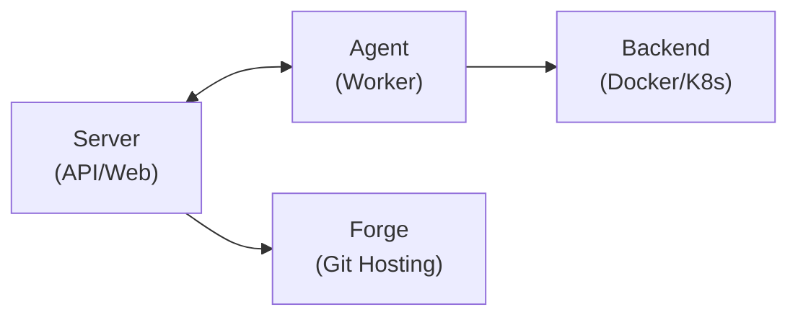

Overview of Crow CI's system architecture and codebase structure.

## Components

Crow CI consists of three main components:



### Server

Central orchestration hub and API gateway.

- **Location**: `/cmd/server/`, `/server/`
- **API**: RESTful endpoints (`/server/api/`)
- **gRPC**: Agent communication (`/server/grpc/`)
- **Database**: XORM ORM (`/server/store/`)
- **Forges**: GitHub, GitLab, Forgejo, Gitea, Bitbucket (`/server/forge/`)

### Agent

Distributed pipeline execution workers.

- **Location**: `/cmd/agent/`, `/agent/`
- **Connection**: gRPC to server
- **Backends**: Docker, Kubernetes, Local (`/pipeline/backend/`)

#### Agent protocol changes

Agents are often run by third parties who upgrade later than the server, so `pipeline/rpc/proto/crow.proto` must stay readable by older agents.

- Increase `Version` in `pipeline/rpc/proto/version.go` on every change to `crow.proto`, so each side can tell which fields and RPCs the other understands.
- Keep changes additive: add fields and RPCs, and reserve the numbers of removed fields.
- Raise `MinAgentVersion` only for a change older agents cannot read, such as removing a field or changing its type or meaning.
- Never change `LegacyVersion`, since agents predating protocol negotiation compare it for an exact match.

The `check-proto-compat` CI step runs `buf breaking` against the target branch and fails when a breaking change lands without raising `MinAgentVersion`.

### CLI

Command-line interface for administration.

- **Location**: `/cmd/cli/`, `/cli/`
- **Features**: Repo, pipeline, secret, user management

### Web UI

Vue.js frontend.

- **Location**: `/web/`
- **Stack**: Vue 3, TypeScript, Pinia, Vue Router

## Pipeline System

### Frontend Processing

Pipeline YAML parsing and validation (`/pipeline/frontend/yaml/`):

- YAML parsing and validation
- DAG construction for step dependencies
- Matrix workflow expansion
- Constraint evaluation

### Backend Execution

Pluggable execution backends (`/pipeline/backend/`):

- Container/pod lifecycle management
- Volume, network, secret handling
- Log streaming

## Data Layer

### Models

Core data structures (`/server/model/`):

- User, Repo, Pipeline, Step, Task, Agent
- Secret, Registry, Org

### Store

Database access layer (`/server/store/`):

- XORM ORM abstraction
- Migrations (`/server/store/datastore/migration/`)
- SQLite, PostgreSQL, MySQL support

## Key Directories

```
crow/
├── cmd/
│   ├── server/      # Server entrypoint
│   ├── agent/       # Agent entrypoint
│   └── cli/         # CLI entrypoint
├── server/
│   ├── api/         # REST API handlers
│   ├── grpc/        # gRPC server
│   ├── forge/       # VCS integrations
│   ├── model/       # Data models
│   ├── store/       # Database layer
│   └── pipeline/    # Pipeline orchestration
├── agent/           # Agent logic
├── pipeline/
│   ├── frontend/    # YAML parsing
│   ├── backend/     # Execution backends
│   └── rpc/         # gRPC protocols
├── cli/             # CLI commands
├── web/             # Vue.js frontend
├── shared/          # Common utilities
└── docs/            # Documentation
```
