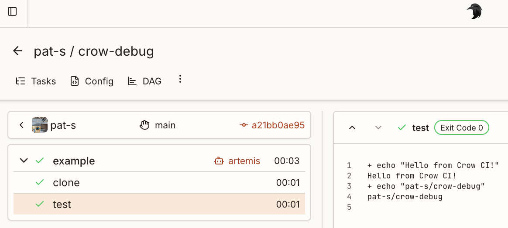

import { Steps } from '@astrojs/starlight/components';

Get Crow CI running in 5 minutes.

## Prerequisites

- A Git forge account (Forgejo, Gitea, GitHub, GitLab, or Bitbucket)
- Docker and Docker Compose installed
- A repository to run pipelines on

## Setup

<Steps>

1. **Create an OAuth application** on your forge:
    - Go to your forge's settings (e.g., Codeberg → Settings → Applications)
    - Create a new OAuth application with:
        - **Name**: Crow CI
        - **Redirect URI**: `http://localhost:8000/authorize`
    - Copy the Client ID and Client Secret

2. **Create a `docker-compose.yml`** file:

    ```yaml
    services:
      server:
        image: codeberg.org/crowci/crow-server:latest
        ports:
          - "8000:8000"
          - "9000:9000"
        volumes:
          - crow-data:/var/lib/crow
        environment:
          - CROW_OPEN=true
          - CROW_HOST=http://localhost:8000
          - CROW_AGENT_SECRET=your-agent-secret
          - CROW_FORGEJO=true
          - CROW_FORGEJO_URL=https://codeberg.org
          - CROW_FORGEJO_CLIENT=your-oauth-client-id
          - CROW_FORGEJO_SECRET=your-oauth-client-secret

      agent:
        image: codeberg.org/crowci/crow-agent:latest
        depends_on:
          - server
        volumes:
          - /var/run/docker.sock:/var/run/docker.sock
        environment:
          - CROW_SERVER=server:9000
          - CROW_AGENT_SECRET=your-agent-secret

    volumes:
      crow-data:
    ```

    :::tip
    Replace `CROW_FORGEJO=true` with your forge type (`CROW_GITHUB`, `CROW_GITLAB`, etc.).
    :::

3. **Start Crow CI**:

    ```sh
    docker compose up -d
    ```

4. **Log in** at `http://localhost:8000` with your forge account.

5. **Add your first pipeline** by creating `.crow/build.yaml` in your repository:

    ```yaml
    steps:
      - name: test
        image: alpine
        commands:
          - echo "Hello from Crow CI!"
          - echo "${CI_REPO}"
    ```

6. **Push** the changes. Crow CI will automatically detect and run the pipeline.

</Steps>



## What's Next?

- [Pipelines](/dev/usage/pipelines/) - Pipeline structure and execution
- [Workflow Syntax](/dev/usage/workflow-syntax/) - Complete configuration reference
- [Secrets](/dev/usage/secrets/) - Manage sensitive data
- [Plugins](/dev/plugins/) - Extend functionality
- [Server Configuration](/dev/configuration/server/) - Production options
