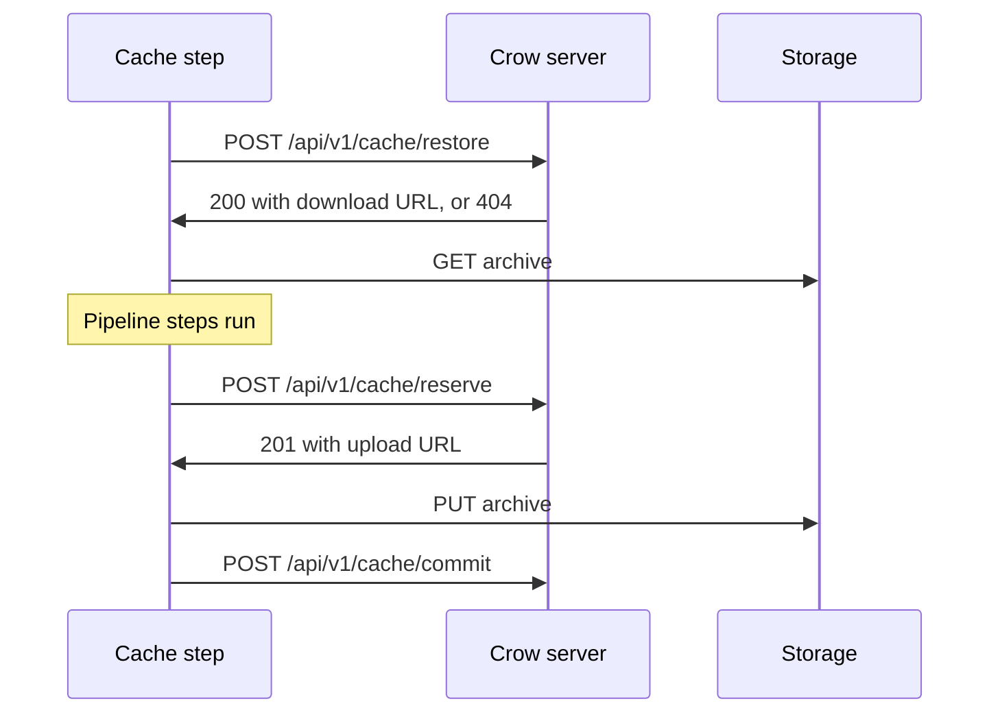

import { Steps } from '@astrojs/starlight/components';

Crow can restore and save workspace paths between pipeline runs, for example dependency or compiler caches.
The server owns storage, quota and cleanup, and steps never see storage credentials.

## Setup

<Steps>

1. **Enable a cache backend on the server**

    Caching is disabled until `CROW_CACHE_BACKEND` is set:

    ```bash
    CROW_CACHE_BACKEND=local
    CROW_CACHE_LOCAL_PATH=/var/lib/crow/cache
    ```

    See the [cache environment variables](/dev/configuration/env-vars/cache/) for S3 storage, quotas and expiry.

2. **Add a `cache` section to the workflow**

    ```yaml
    cache:
      - key: go-{{ arch }}-{{ checksum "go.sum" }}
        restore_keys: ['go-{{ arch }}-']
        paths: [.cache/go]
        save: on_success

    steps:
      build:
        image: golang:1.27
        environment:
          GOMODCACHE: ${CI_WORKSPACE}/.cache/go
        commands: [go build ./...]
    ```

</Steps>

Without a cache backend, a `cache` section produces a linter warning and is ignored.

## Options

| Option         | Required | Description                                                                                |
| -------------- | -------- | ------------------------------------------------------------------------------------------ |
| `key`          | Yes      | Cache key template of at most 255 characters, unique within the workflow                   |
| `restore_keys` | No       | String or list of key prefixes tried when `key` has no cache                               |
| `paths`        | Yes      | String or list of paths relative to the workspace                                         |
| `save`         | No       | `on_success` (default), `always` (also after failed steps), or `never` (restore only)      |

For `restore_keys`, the newest cache whose key starts with the prefix is restored.
Put the parts a fallback must match, such as `{{ arch }}`, before the checksum: with `go-{{ checksum "go.sum" }}-{{ arch }}`, the prefix `go-` also matches caches of other architectures.
Absolute paths and `..` in `paths` are rejected.
With `on_success`, the cache is saved only when all steps succeeded.

Only the workspace is shared between steps, so point tool caches into it.
Common variables are `GOMODCACHE`, `npm_config_cache`, `PIP_CACHE_DIR` and `CARGO_HOME`.

## Key templates

`key` and `restore_keys` are Go templates rendered in the cache step after the clone.
The following functions are available:

| Function                 | Description                                                                                         |
| ------------------------ | --------------------------------------------------------------------------------------------------- |
| `checksum "pattern" ...` | SHA-256 over the paths and contents of all files matching the glob patterns, relative to the workspace |
| `os`                     | Operating system of the cache step container                                                        |
| `arch`                   | Architecture of the cache step container                                                            |

`checksum` supports `**` and fails when no file matches.
A YAML value starting with `{{` must be quoted, for example `key: "{{ arch }}-build"`.
`${VAR}` substitution of CI variables still happens at compile time, as everywhere else in the configuration.

The key is rendered again when saving.
If a step changes a checksummed file, the cache is saved under the new key.

Keys are immutable.
If the exact key already exists in any scope the run can read, saving is skipped.
A key without a template, such as `key: build-cache`, is therefore saved once and never updated, with `save: always` too.
To replace a cache, use a new key, for example by bumping a `v1-` prefix.

## Execution

The compiler adds a `restore-cache` step after the clone, and all other steps wait for it.
It adds a `save-cache` step after all steps, plus a `save-cache-always` step for entries with `save: always`.

Cache steps never fail the workflow.
Failed transfers and server errors are retried three times with backoff, and a restore that breaks off removes what it had extracted before starting over.
A transfer that moves no data for a minute counts as failed and is retried the same way.
While archiving, uploading or downloading, the step logs its progress every ten seconds, so a large cache shows how far it got and how fast it moves.
An entry whose archive was removed from storage outside Crow, for example by a bucket lifecycle rule, is dropped on its next restore, and the save step of that pipeline stores it again.
Problems that remain, such as an exceeded quota, are logged as warnings.
While the server's cache storage is unavailable, the step logs `warning: the build cache storage is unavailable, skipping caching` and does nothing else.
Cancelled pipelines do not save.

Archives are tar files compressed with zstd.
Symlinks are stored as links, and restoring never writes outside the declared paths.

## Scoping

Every cache belongs to the git ref it was saved from: `refs/heads/<branch>`, `refs/tags/<tag>`, or the forge's pull request ref.
A run restores from its own ref first, then from the pull request's target branch, then from the repository's default branch.
A run saves only to its own ref.
Pull requests from forks may restore but never save.
This prevents a branch or pull request from poisoning the cache that the default branch restores.

## Managing caches

Repository admins can list and delete caches in the **Caches** tab of the repository settings.

The CLI offers the same operations:

```bash
# list caches of a repository
crow repo cache ls <repo>
# delete a single cache
crow repo cache rm <repo> <cache-id>
# delete all caches of a repository
crow repo cache purge <repo>
```

The API endpoints are `GET /api/v1/repos/{repo_id}/caches`, `DELETE /api/v1/repos/{repo_id}/caches` and `DELETE /api/v1/repos/{repo_id}/caches/{cache_id}`.

The **Caches** tab also shows the hit rate of the last 30 days.

### Users and organizations

The **Caches** tab of the organization settings, and of a user's own organization, shows the caches of all its repositories:
size, hit rate and egress, the restores per day of the last 30 days and a breakdown per repository.
Organization admins can delete all caches of the organization there.

A restore counts as a hit when it found the key, as a restore key hit when it fell back to one of the `restore_keys`, and as a miss otherwise.
The check a save makes before archiving is not counted.
Egress is the size of the archives handed out to restore, ingress the size of the archives saved.

### Server administrators

**Admin Settings > Caches** lists the caches of every user and organization with their size, hit rate, egress of the current month and retention.
Users with the `maintenance:read` permission can view it, `maintenance:write` is needed to change anything.
From there, admins can

- set a size limit, a monthly egress limit and a retention period per user or organization, each either the server default, unlimited or a custom value,
- delete all caches of a user or organization,
- run the cleanup at once instead of waiting for the next run.

Lowering a size limit evicts the least recently used caches of the owner right away.

The same is available from the CLI and the API:

```bash
# list the caches and limits of all users and organizations
crow admin cache ls
# give a user 20 GiB and keep their caches for two weeks
crow admin cache set <user-login> --max-size 20GiB --ttl 14d
# lift the monthly egress limit of an organization
crow admin cache set <org-name> --max-egress unlimited
```

`crow admin cache set` only changes the limits it is given; `default` returns a limit to the server default and `unlimited` lifts it.

The API endpoints are `GET /api/v1/admin/caches`, `GET`, `PUT` and `DELETE /api/v1/admin/caches/orgs/{org_id}`, and `POST /api/v1/admin/caches/cleanup`.
A user's caches belong to their personal organization, whose ID `GET /api/v1/orgs/lookup/{login}` returns.
`PUT` replaces all three limits at once:

```json
{ "max_size": 21474836480, "max_egress": 0, "ttl": 1209600 }
```

`max_size` and `max_egress` are bytes, `ttl` is seconds; `0` applies the server default and `-1` lifts the limit.

The defaults come from `CROW_CACHE_MAX_ORG_SIZE`, `CROW_CACHE_MAX_ORG_EGRESS` and `CROW_CACHE_TTL`, and `CROW_CACHE_MAX_REPO_SIZE` and `CROW_CACHE_MAX_TOTAL_SIZE` apply on top.

Egress is counted per calendar month in UTC.
A restore that would exceed the monthly egress limit is skipped: the step logs `not restoring <key>: the monthly cache download limit is reached` and the pipeline continues without the cache.

### Own buckets

Users and organizations can keep their caches in an S3-compatible bucket of their own instead of the server's storage.
An organization admin enters the endpoint, bucket, optional key prefix and credentials in the **Own bucket** section of the organization's **Caches** tab.
The server checks that it can reach the bucket before saving it.

- Cache steps up- and download through presigned URLs, so the endpoint must be reachable from pipeline steps.
- The server's size and egress limits do not apply to an own bucket, and admins cannot change its settings.
  Instead the owner sets, in the same form:
  - a size limit, beyond which the least recently used caches in the bucket are evicted,
  - a monthly egress limit, beyond which restores from the bucket are skipped until the next calendar month (UTC),
  - a retention period, or the server default.
  The size and egress limits are unlimited unless set.
- Connecting, disconnecting or moving a bucket to another endpoint, bucket or prefix starts the caches over: the caches kept in the previous location are deleted.
  Changing only the credentials or the retention keeps them.
- The secret key is never sent back to the browser; leave it empty when editing to keep the current one.
  It is encrypted at rest when the server's secret encryption is enabled.
- The endpoint must be a public address.
  Admins can allow endpoints on the local network with `CROW_CACHE_ALLOW_PRIVATE_BUCKET_ENDPOINTS=true`.

Admins can turn off own buckets with `CROW_CACHE_ALLOW_USER_BUCKETS=false`.
The caches in buckets already connected are then neither used nor deleted, until own buckets are turned on again.

The management API endpoints are:

| Request | Permission | Description |
| --- | --- | --- |
| `GET /api/v1/admin/caches` | `maintenance:read` | Caches, usage and limits of all users and organizations |
| `GET /api/v1/admin/caches/orgs/{org_id}` | `maintenance:read` | Caches of one owner per repository and day |
| `PUT /api/v1/admin/caches/orgs/{org_id}` | `maintenance:write` | Set `max_size`, `max_egress` (bytes) and `ttl` (seconds); `0` is the server default, `-1` unlimited |
| `DELETE /api/v1/admin/caches/orgs/{org_id}` | `maintenance:write` | Delete all caches of one owner |
| `POST /api/v1/admin/caches/cleanup` | `maintenance:write` | Remove expired caches and enforce size limits now |
| `GET /api/v1/orgs/{org_id}/caches` | organization admin | Caches and usage of the organization |
| `DELETE /api/v1/orgs/{org_id}/caches` | organization admin | Delete all caches of the organization |
| `PUT /api/v1/orgs/{org_id}/caches/bucket` | organization admin | Connect or change the own bucket, including its `max_size`, `max_egress` (bytes, `0` unlimited) and `ttl` |
| `DELETE /api/v1/orgs/{org_id}/caches/bucket` | organization admin | Disconnect the own bucket |

## How it works

When an agent picks up a workflow, the server mints a token for that workflow.
It injects `CI_CACHE_URL` and `CI_CACHE_TOKEN` into the cache steps only, and masks the token in logs.
The server accepts the token only while the workflow is running.



With the `local` backend, the storage URLs point to the server itself, which streams the archives.
With `s3`, they are presigned S3 URLs valid for one hour, so the S3 endpoint must be reachable from pipeline steps.
An S3 archive larger than 16 MiB is uploaded as a multipart upload in 16 MiB parts, up to 32 at a time, because object stores accept only a few MB/s per connection.
Incomplete multipart uploads of abandoned saves are aborted when their entry is cleaned up.
In both cases cache steps reach the server at `CROW_HOST`, which must be reachable from steps as well.

The step-facing endpoints authenticate with `Authorization: Bearer $CI_CACHE_TOKEN`:

| Request                                      | Body                    | Responses                                                                                         |
| -------------------------------------------- | ----------------------- | ------------------------------------------------------------------------------------------------- |
| `POST /api/v1/cache/restore`                 | `{key, restore_keys, check}` | `200 {id, key, scope, size, exact, url}`, `404` on a miss, `429` egress limit reached; `check: true` only tests whether the key exists: it is not counted and returns no `id` or `url` |
| `POST /api/v1/cache/reserve`                 | `{key, size, multipart}` | `201 {id, url, upload_id, part_size, part_urls}`, `409` key exists, `403` read-only (fork pull request), `507` quota exceeded |
| `PUT <url>` or `PUT <part_urls[i]>`          | archive or part `i`     | Presigned S3 URL, or `/api/v1/cache/blobs/{id}` with the same Bearer token for local storage       |
| `POST /api/v1/cache/commit`                  | `{id, upload_id}`       | Assembles the parts, if any, and marks the upload as complete                                      |

With `multipart: true`, the server may answer with `part_urls` instead of a single upload: part `i` holds the archive bytes from `i * part_size` on, and the commit passes the `upload_id`.
Only the built-in cache steps receive a token, other plugins do not.

## Limitations

- The local, Tart and Hyper-V backends do not run cache steps yet.
- `crow exec` ignores the `cache` section.
