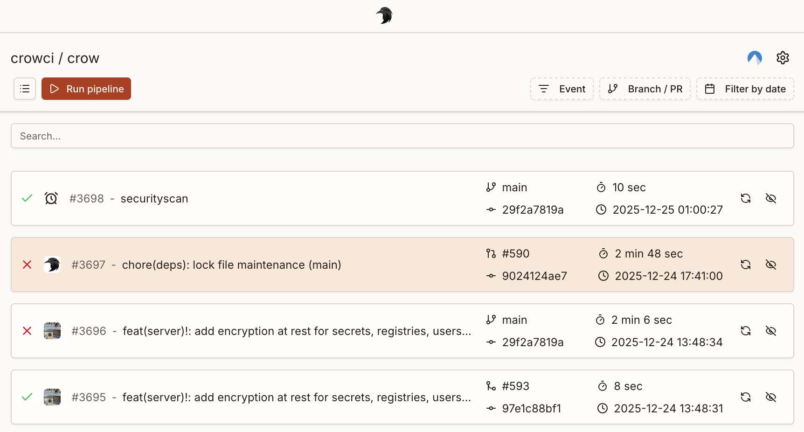
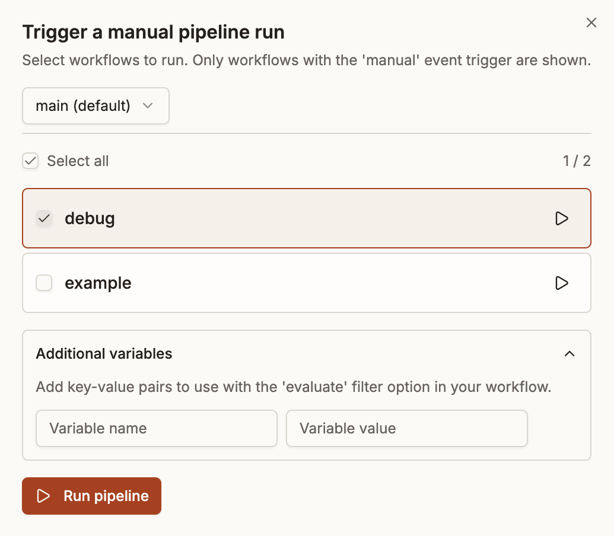

A pipeline consists of **one or more** workflows.
A workflow consist of **one or more** steps.

:::caution
Pipeline > Workflow > Step
:::

A YAML file in `.crow/` defines _one or more_ workflow(s) ("more" if a "matrix" workflow is defined).
The following file tree would consist of _four_ workflows:

```tree
.crow/
├── build.yaml
├── deploy.yaml
├── lint.yaml
└── test.yaml
```

Each workflow can consist of an arbitrary number of steps.
By default, workflows do not have a dependency to each other and are executed in parallel.
Steps within a workflow are executed sequentially by their order of definition.

Both steps and workflows accept a `depends_on: []` key which can be used to specify an explicit execution order.

:::caution
Each workflow is isolated from other workflows with respect to its working directory and file access.
_Steps within a workflow_ have access to the same files as they share a common workflow-specific volume which is attached to all steps within the workflow.
:::

## Execution control

By default, all workflows start in parallel if they have matching event triggers.
An execution order can be enforced by using `depends_on`:

```yaml
steps:
  - name: deploy
    image: <image>:<tag>
    commands:
      - some command

# these are names of other workflows
depends_on:
  - lint
  - build
  - test
```

This keyword also works for dependency resolution with steps.

:::note
Workflows which depend on others only start if the dependent ones finished successfully.
A workflow can be forced to execute no matter the exit status of other workflows by setting

```yaml
runs_on: [success, failure]
```

:::

## Event triggers

Event triggers are _mandatory_ and define under which conditions a workflow is executed.
At the very least one even trigger must be specified, for example to execute the pipeline on a `push` event:

```yaml
when:
  event: push
```

Typically, you want to use a more fine-grained logic including more events, for example triggering a workflow for `pull_request` events and pushes to the default branch of the repository:

```yaml
when:
  - event: pull_request
  - event: push
    branch: ${CI_REPO_DEFAULT_BRANCH}
```

There are more ways to define event triggers using both list and map notation.
Please see FIXME for all available options.

## Matrix workflows

Matrix workflows execute a separate workflow for each combination in the specified matrix.
This simplifies testing and building against multiple configurations without copying the full pipeline definition but only declare the variable parts.

Example:

```yaml
matrix:
  GO_VERSION:
    - 1.4
    - 1.3
  REDIS_VERSION:
    - 2.6
    - 2.8
    - 3.0
```

Each definition can also be a combination of variables.
In this case, nest the definitions below the `include` keyword:

```yaml
matrix:
  include:
    - GO_VERSION: 1.4
      REDIS_VERSION: 2.8
    - GO_VERSION: 1.5
      REDIS_VERSION: 2.8
```

### Interpolation

Matrix variables are interpolated in the YAML using the `${VARIABLE}` syntax, **before the YAML is parsed**.
This is an example YAML file **before** interpolating matrix parameters:

```yaml
matrix:
  GO_VERSION:
    - 1.4
    - 1.3
  DATABASE:
    - mysql:8
    - mysql:5
    - mariadb:10.1

steps:
  - name: build
    image: golang:${GO_VERSION}
    commands:
      - go get
      - go build
      - go test

services:
  - name: database
    image: ${DATABASE}
```

And after:

```yaml
steps:
  - name: build
    image: golang:1.4
    commands:
      - go get
      - go build
      - go test
    environment:
      - GO_VERSION=1.4
      - DATABASE=mysql:8

services:
  - name: database
    image: mysql:8
```

### Examples

#### Matrix pipeline with a variable image tag

  ```yaml
  matrix:
    IMAGE:
      - golang:1.7
      - golang:1.8
      - golang:latest

  steps:
    - name: build
      image: ${IMAGE}
      commands:
        - go build
        - go test
  ```

#### Matrix pipeline using multiple platforms

  ```yaml
  matrix:
    platform:
      - linux/amd64
      - linux/arm64

  steps:
    - name: test
      image: <image>
      commands:
        - echo "Running on ${platform}"

    - name: test-arm
      image: <image>
      commands:
        - echo "Running on ${platform}"
      when:
        platform: linux/arm*
  ```

  :::tip
  For the kubernetes backend, architecture-specific pipelines should be controlled via the [`nodeSelector` backend option](/dev/configuration/server/#backend-options-1).
  :::

## Skipping commits

Commits can be prohibited from triggering a webhook by adding `[SKIP CI]` or `[CI SKIP]` (case-insensitive) to the commit message.

## Container Naming Scheme

Crow supports configurable container naming schemes which determines the names of containers (and pods/services in Kubernetes) created during pipeline execution.

There are two supported schemes:

1. Descriptive (default)

    - **Format:** `<owner>-<repo name>-<pipeline id>-<workflow id>-<step name>`
    - **Example:** `myowner-myrepo-42-3-build`
    - **Matrix workflows:** Each workflow instance gets a unique workflow number for proper identification
    - **Single workflows:** Workflow number is still included for consistency

2. Hash-based (legacy)

    - **Format:** `crow_<hash>`
    - **Example:** `crow_123e4567-e89b-12d3-a456-426614174000`
    - This was previously the default (until 3.x) (as `wp_<hash>`), now updated to `crow_` for clarity.

:::note
Names are sanitized and truncated to 64 characters for Kubernetes compatibility.
:::

The naming scheme can be set via the server environment variable `CROW_CONTAINER_NAME_SCHEME`.

## Manual Pipeline Triggering

Pipelines can be triggered manually from the UI or CLI. To enable manual triggering for a workflow, add the `manual` event to the `when` block:

```yaml
when:
  - event: manual
```

Or combined with other events:

```yaml
when:
  - event: [push, manual]
    branch: main
```

### UI Workflow Selection

When triggering a manual pipeline from the UI, you'll see a list of all workflows that have the `manual` event configured. You can:

- **Select multiple workflows**: Check the workflows you want to run and click "Trigger"
- **Quick-start a single workflow**: Click the play button next to any workflow to immediately start just that workflow
- **Select all**: Use the "Select all" checkbox to select all available workflows

<div style="max-width: 400px; margin: 1rem auto;">

</div>

### Dependency Handling

When a selected workflow depends on other workflows (via `depends_on`), the system automatically includes those dependencies if they also have the `manual` event trigger.

For example, given these workflows:

```yaml
# .crow/build.yaml
when:
  - event: manual

steps:
  - name: build
    image: golang
    commands:
      - go build
```

```yaml
# .crow/deploy.yaml
when:
  - event: manual

depends_on:
  - build

steps:
  - name: deploy
    image: alpine
    commands:
      - ./deploy.sh
```

If you select only "deploy", the "build" workflow will be automatically included because:
1. "deploy" depends on "build"
2. "build" has the `manual` event trigger

:::caution
Dependencies that do **not** have the `manual` event trigger will not be automatically included. A warning will be shown in the UI when this occurs.
:::

### CLI Triggering

Manual pipelines can also be triggered via the CLI:

```bash
crow pipeline create --branch main --repo owner/repo
```

To run specific workflows, use the `--workflow` flag:

```bash
crow pipeline create --branch main --repo owner/repo --workflow build --workflow test
```

### Filtering with Evaluate

The `evaluate` condition can be used to further filter manual workflows. This is useful when you want to pass variables to control which steps run:

```yaml
when:
  - event: manual
    evaluate: 'DEPLOY_ENV == "production"'
```

When triggering manually via the CLI, you can pass variables:

```bash
crow pipeline create --branch main --repo owner/repo --var DEPLOY_ENV=production
```
