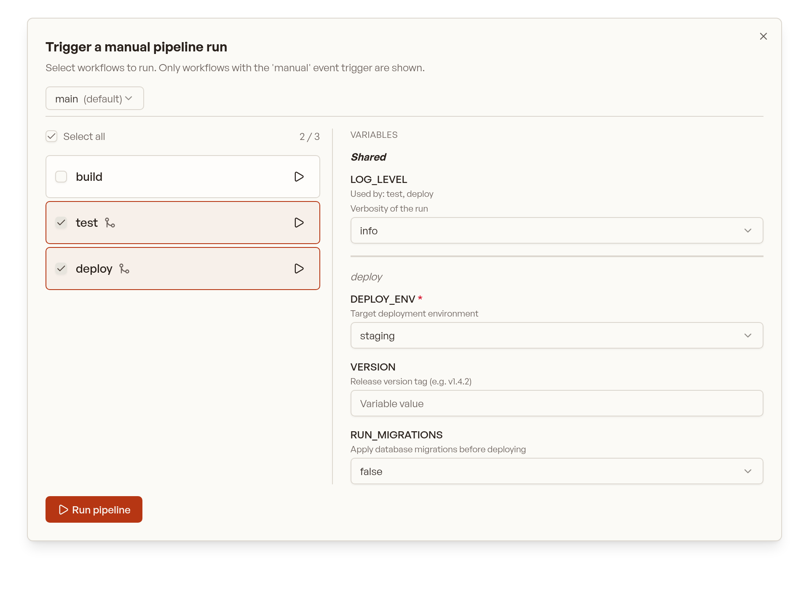

## Concepts

Crow uses a three-level hierarchy: **pipeline > workflow > step**.

- **Pipeline** — a single CI invocation. A pipeline is _not_ defined in a file; it is created at runtime in response to one event (push, pull request, manual run, ...) and bundles all workflows that match that event.
- **Workflow** — a YAML file in `.crow/` (or [Jsonnet](/dev/usage/jsonnet/) `.jsonnet`) defining a collection of steps. This is what you author to describe what should run.
- **Step** — a single command sequence executed inside a container.

:::caution
Pipeline > Workflow > Step
:::

When an event reaches Crow, every workflow whose `when` block matches that event is collected into _one_ pipeline and executed.
A push that matches three workflow files results in **one** pipeline containing three workflows — not three pipelines.
The pipeline is the run; the workflows are what runs inside it.

Each YAML file in `.crow/` defines _one_ workflow.
A workflow that uses a [matrix](#matrix-workflows) expands at runtime into one workflow instance per matrix combination, so a single matrix file can produce multiple workflows in the resulting pipeline.

The following file tree defines _four_ workflows:

```tree
.crow/
├── build.yaml
├── deploy.yaml
├── lint.yaml
└── test.yaml
```

Each workflow can consist of an arbitrary number of steps.
By default, workflows do not have a dependency to each other and are executed in parallel.
Steps within a workflow are executed sequentially by their order of definition.

Both steps and workflows accept a `depends_on: []` key which can be used to specify an explicit execution order.

:::caution
Each workflow is isolated from other workflows with respect to its working directory and file access.
_Steps within a workflow_ have access to the same files as they share a common workflow-specific volume which is attached to all steps within the workflow.
:::

## Execution control

By default, all workflows start in parallel if they have matching event triggers.
An execution order can be enforced by using `depends_on`:

```yaml
steps:
  - name: deploy
    image: <image>:<tag>
    commands:
      - some command

# these are names of other workflows
depends_on:
  - lint
  - build
  - test
```

This keyword also works for dependency resolution with steps.

:::note
Workflows which depend on others only start if the dependent ones finished successfully.
A workflow can be forced to execute no matter the exit status of other workflows by setting

```yaml
runs_on: [success, failure]
```

:::

## Event triggers

Event triggers are _mandatory_ and define under which conditions a workflow is executed.
At the very least one even trigger must be specified, for example to execute the pipeline on a `push` event:

```yaml
when:
  event: push
```

Typically, you want to use a more fine-grained logic including more events, for example triggering a workflow for `pull_request` events and pushes to the default branch of the repository:

```yaml
when:
  - event: pull_request
  - event: push
    branch: ${CI_REPO_DEFAULT_BRANCH}
```

There are more ways to define event triggers using both list and map notation.
See the [`when` filters reference](/dev/usage/workflow-syntax/#when-1) for all available options and the [full list of events](/dev/usage/workflow-syntax/#event).

## Matrix workflows

Matrix workflows execute a separate workflow for each combination in the specified matrix.
This simplifies testing and building against multiple configurations without copying the full pipeline definition but only declare the variable parts.

Example:

```yaml
matrix:
  GO_VERSION:
    - 1.4
    - 1.3
  REDIS_VERSION:
    - 2.6
    - 2.8
    - 3.0
```

Each definition can also be a combination of variables.
In this case, nest the definitions below the `include` keyword:

```yaml
matrix:
  include:
    - GO_VERSION: 1.4
      REDIS_VERSION: 2.8
    - GO_VERSION: 1.5
      REDIS_VERSION: 2.8
```

### Interpolation

Matrix variables are interpolated in the YAML using the `${VARIABLE}` syntax, **before the YAML is parsed**.
This is an example YAML file **before** interpolating matrix parameters:

```yaml
matrix:
  GO_VERSION:
    - 1.4
    - 1.3
  DATABASE:
    - mysql:8
    - mysql:5
    - mariadb:10.1

steps:
  - name: build
    image: golang:${GO_VERSION}
    commands:
      - go get
      - go build
      - go test

services:
  - name: database
    image: ${DATABASE}
```

And after:

```yaml
steps:
  - name: build
    image: golang:1.4
    commands:
      - go get
      - go build
      - go test
    environment:
      - GO_VERSION=1.4
      - DATABASE=mysql:8

services:
  - name: database
    image: mysql:8
```

### Examples

#### Matrix pipeline with a variable image tag

  ```yaml
  matrix:
    IMAGE:
      - golang:1.7
      - golang:1.8
      - golang:latest

  steps:
    - name: build
      image: ${IMAGE}
      commands:
        - go build
        - go test
  ```

#### Matrix pipeline using multiple platforms

  ```yaml
  matrix:
    platform:
      - linux/amd64
      - linux/arm64

  steps:
    - name: test
      image: <image>
      commands:
        - echo "Running on ${platform}"

    - name: test-arm
      image: <image>
      commands:
        - echo "Running on ${platform}"
      when:
        platform: linux/arm*
  ```

  :::tip
  For the kubernetes backend, architecture-specific pipelines should be controlled via the [`nodeSelector` backend option](/dev/configuration/server/#backend-options-1).
  :::

## Skipping commits

Commits can be prohibited from triggering a webhook by adding `[SKIP CI]` or `[CI SKIP]` (case-insensitive) to the commit message.

## Container Naming Scheme

Crow supports configurable container naming schemes which determines the names of containers (and pods/services in Kubernetes) created during pipeline execution.

There are two supported schemes:

1. Descriptive (default)

    - **Format:** `<owner>-<repo name>-<pipeline id>-<workflow id>-<step name>`
    - **Example:** `myowner-myrepo-42-3-build`
    - **Matrix workflows:** Each workflow instance gets a unique workflow number for proper identification
    - **Single workflows:** Workflow number is still included for consistency

2. Hash-based (legacy)

    - **Format:** `crow_<hash>`
    - **Example:** `crow_123e4567-e89b-12d3-a456-426614174000`
    - This was previously the default (until 3.x) (as `wp_<hash>`), now updated to `crow_` for clarity.

:::note
Names are sanitized and truncated to 64 characters for Kubernetes compatibility.
:::

The naming scheme can be set via the server environment variable `CROW_CONTAINER_NAME_SCHEME`.

## Manual Pipeline Triggering

A pipeline can be triggered manually from the UI or CLI instead of by a forge event such as `push` or `pull_request`.
Manual runs are the way to start deployments, releases, one-off maintenance jobs, or anything else you want to launch on demand, optionally parameterized with variables the user fills in first.

### Enabling manual triggering

A workflow only appears in the manual trigger dialog when its `when` block contains the `manual` event.
Add it on its own to make the workflow manual-only:

```yaml
when:
  - event: manual
```

Or list it alongside other events so the same workflow still runs automatically:

```yaml
when:
  - event: [push, manual]
    branch: main
```

Workflows without the `manual` event are never listed and cannot be started by hand.

### Declaring variables

Manual runs can be parameterized with variables that the user sets before the pipeline starts.
Declare them in the workflow's top-level `variables:` block, keyed by variable name.
Each entry accepts these fields:

| Field         | Type             | Purpose                                                                                             |
| ------------- | ---------------- | --------------------------------------------------------------------------------------------------- |
| `description` | string           | Helper text shown beneath the field in the UI.                                                      |
| `options`     | list of strings  | Restricts the value to a fixed set and renders it as a dropdown instead of a free-text input.        |
| `default`     | string           | Pre-filled value; for `options` it selects the initially chosen entry.                              |
| `required`    | boolean          | When `true`, the field is marked with `*` and the pipeline cannot start until it has a value.        |

A worked example for a deploy workflow:

```yaml
# .crow/deploy.yaml
variables:
  DEPLOY_ENV:
    description: Target deployment environment
    options: [staging, production]
    default: staging
    required: true
  VERSION:
    description: Release version tag (e.g. v1.4.2)
    default: ''
  RUN_MIGRATIONS:
    description: Apply database migrations before deploying
    options: ['true', 'false']
    default: 'false'
  # Shorthand: a bare scalar is a variable with only a default.
  LOG_LEVEL: info

when:
  - event: manual
```

The shorthand form `NAME: value` is equivalent to a declaration carrying only a `default`.
Every value reaches the pipeline as a string, so quote booleans and numbers (`'true'`, `'3.12'`) to stop YAML from coercing them.
Inside the workflow a variable is available for `$VAR` substitution in commands and for [`when.evaluate`](/dev/usage/workflow-syntax/#evaluate) expressions.
A variable used only via `$VAR` substitution, and never in `evaluate`, must be declared here to be settable.

#### Variables inferred from `evaluate`

Variables referenced in a `when.evaluate` expression are surfaced in the dialog automatically, even without a `variables:` declaration.
Their names are extracted from the expression, and simple `==` or `in` comparisons against string literals become dropdown options:

```yaml
when:
  - event: manual
    evaluate: 'DEPLOY_ENV in ["staging", "production"]'
```

The snippet above surfaces a `DEPLOY_ENV` dropdown offering `staging` and `production` with no `variables:` block at all.
An explicit declaration always wins over what is inferred, so declare the variable when you also want a description, a default, or the `required` flag.
Built-in `CI_*` variables and the deployment `task` selector are never offered as inputs.

### Triggering from the UI

Open the manual trigger dialog from the repository's pipeline list.
It has two columns: the available workflows on the left and their variables on the right.
Choose a branch or a tag at the top; the workflow list and variables reflect the configuration at that ref.

<div style="max-width: 760px; margin: 1rem auto;">

</div>

Only workflows with the `manual` event are listed. From the left column you can:

- **Select workflows**: click anywhere on a row (or its checkbox) to include it, then click **Run pipeline**. The selected workflows are bundled into one new pipeline.
- **Quick-start a single workflow**: click the play button on a row to immediately start a pipeline containing just that workflow, using each variable's default.
- **Select all**: use the **Select all** checkbox to include every listed workflow.

Workflows that depend on others show a branch icon next to their name; hover it to see the dependencies.

#### Running from a tag

The ref picker lists the repository's branches and tags in separate groups, filtered by a single search box.

A run started from a tag is still a `manual` event, so the same workflows are offered as for a branch.
Its ref is `refs/tags/<tag>`, which means `CI_COMMIT_TAG` is set just as it is for a `tag` event.
The run is not associated with a branch, so a workflow gated on `when: branch` will not match it.
Gate on `when: event: manual` instead if a workflow should be runnable from both branches and tags.

Tag support depends on the forge.
Gitea, Forgejo, GitHub and GitLab can list tags; on Bitbucket, Bitbucket Datacenter and forge addons the **Tags** group is not shown and only branches can be selected.

### Setting variables in the UI

The right column shows the variables of the currently selected workflows, grouped so it is clear which variable belongs where.
A variable declared by more than one selected workflow appears once in a **Shared** group at the top, annotated with a **Used by** note; each remaining workflow's variables follow under its own heading.
In the screenshot below both `test` and `deploy` declare `LOG_LEVEL`, so it is shown once under **Shared**, while `deploy`'s own variables sit under the `deploy` heading.

<div style="max-width: 760px; margin: 1rem auto;">

</div>

Each field renders according to its declaration:

- variables with `options` render as a dropdown, everything else as a text input;
- every field is pre-filled with its declared `default`;
- required variables are marked with `*` and must be set before **Run pipeline** is enabled.

Free-form variable entry is not available: only declared or `evaluate`-referenced variables can be set.
Submitting a value outside a variable's declared options, or omitting a required variable, is rejected.

### Dependency handling

When a selected workflow depends on other workflows (via `depends_on`), the system automatically includes those dependencies if they also have the `manual` event trigger.

For example, given these workflows:

```yaml
# .crow/build.yaml
when:
  - event: manual

steps:
  - name: build
    image: golang
    commands:
      - go build
```

```yaml
# .crow/deploy.yaml
when:
  - event: manual

depends_on:
  - build

steps:
  - name: deploy
    image: alpine
    commands:
      - ./deploy.sh
```

If you select only "deploy", the "build" workflow will be automatically included because:
1. "deploy" depends on "build"
2. "build" has the `manual` event trigger

:::caution
Dependencies that do **not** have the `manual` event trigger will not be automatically included. A warning will be shown in the UI when this occurs.
:::

### CLI triggering

Manual pipelines can also be triggered from the CLI, which is handy for scripts and scheduled jobs.
The repository is a positional argument (its ID or full name), and exactly one of `--branch` or `--tag` is required:

```bash
crow pipeline create --branch main owner/repo
```

```bash
crow pipeline create --tag v1.4.2 owner/repo
```

Passing both, or neither, is rejected before any request is sent.

Pass variables with `--var NAME=value`, repeating the flag for each variable:

```bash
crow pipeline create --branch main --var DEPLOY_ENV=production --var VERSION=v1.4.2 owner/repo
```

All workflows matching the ref are considered; use `when.evaluate` (see below) to control which ones actually run.
A run created with `--tag` follows the same rules as one started from the UI, so it is not associated with a branch.

### Using variables to control what runs

Because variables are available in `when.evaluate`, they can gate whole workflows or individual steps at runtime.
A step or workflow whose `evaluate` resolves to `false` is skipped, so the same manual pipeline can behave differently depending on the values entered:

```yaml
when:
  - event: manual

steps:
  - name: deploy
    image: alpine
    commands:
      - ./deploy.sh
    when:
      - evaluate: 'DEPLOY_ENV == "production"'
```

Here the `deploy` step only runs when `DEPLOY_ENV` is set to `production`, whether the pipeline was started from the UI or with `--var DEPLOY_ENV=production` on the CLI.

:::caution
If every step is filtered out by its `when` conditions, no pipeline is created and the UI reports that all steps were filtered out.
:::
