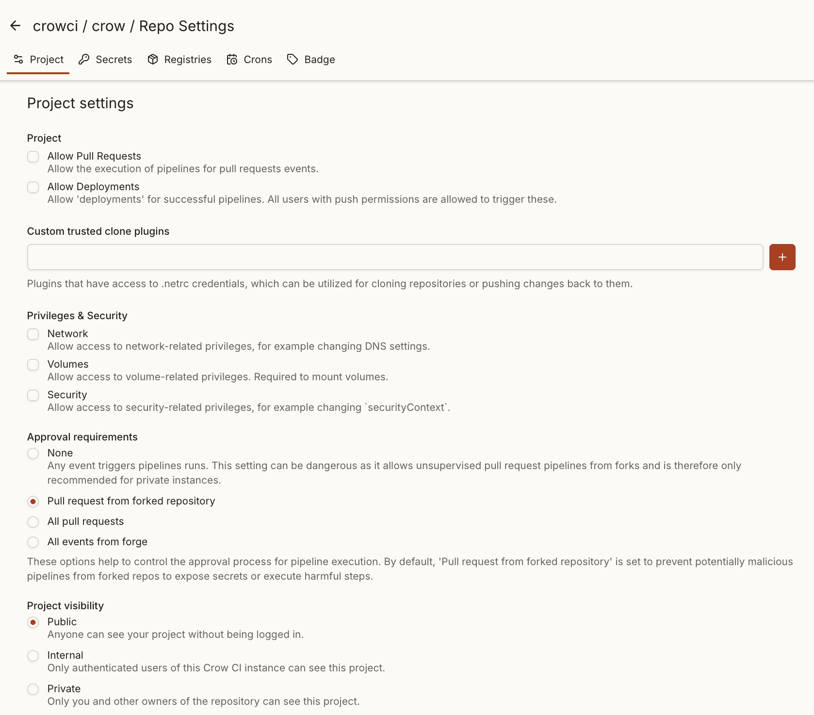

import { Steps } from '@astrojs/starlight/components';

The owner of a repository in the linked forge can change the related Crow CI settings via the web interface.

## General

### Allow pull requests

When enabled, webhooks for pull request events are issued.
If disabled, no pipelines will be triggered for PR events.

### Allow deployments

When enabled, pipelines can be started via "deployment" events.
This includes both webhook triggers from forges for this event and the use of the "deployment" button in the Crow CI UI, which is shown when **all steps** of a pipelines succeeded.

By default, any user with "push" (write) access to the repository can trigger deployments.

#### Restrict to team

For stricter access control, you can restrict deployments to members of a specific forge team:

<Steps>

1. **Enable deployments**

    Check the **Deployments** option (see above)

2. **Set the team restriction**

    In the **Restrict to Team** field, enter the team name (e.g., `crowci-deploy-team`)

</Steps>

When configured:

- Only members of the specified team can trigger deployments
- Team membership is verified against the forge at deployment time
- Instance admins do **not** bypass this check—team membership is always required

See the [Deployment](/dev/usage/deployment/) documentation for more details on permissions.

## Custom trusted clone plugins

During the clone process, sometimes Git credentials (e.g., for private repositories) are required. These credentials are provided via [netrc](https://linux.die.net/man/5/netrc).

They are injected only into "trusted" plugins, specified in the environment variable `CROW_PLUGINS_TRUSTED_CLONE` (an instance-wide server setting) or declared in this repository-level setting.

With these credentials, it is possible to perform arbitrary Git operations, including pushing changes back to the repo.
To prevent unauthorized access or misuse, a plugin allowlist is required, either on the instance level or the repository level.
Without such, a malicious contributor could use a custom clone plugin in a pull request to reveal or transfer these credentials.

:::caution
This setting does not affect subsequent steps, **nor does it allow direct pushes to the repository**.
To enable pushing changes within a workflow, inject Git credentials as a secret or use a dedicated plugin, such as [appleboy/drone-git-push](https://github.com/appleboy/drone-git-push).
:::

## Privileges & Security

These settings give the underlying containers access to escalated capabilities which refer to common container capabilities defined in the [docker/docker "Config"](https://pkg.go.dev/github.com/docker/docker/api/types/container#Config) type.

### Network

With the `network` privilege, containers are given the following capabilities:

- DNS
- DNS search
- ExtraHosts
- NetworkMode

The underlying config object is defined in the [docker/docker network "EndPointSettings"](https://pkg.go.dev/github.com/docker/docker/api/types/network#EndpointSettings) type.

### Volumes

With the `volumes` privilege, containers are given the following capabilities:

- Volumes
- Devices (undocumented)
- Tmpfs (undocumented)

The underlying config object is defined in the [docker/docker volumes "VolumeCreate"](https://pkg.go.dev/github.com/moby/moby@v27.5.1+incompatible/client#Client.VolumeCreate) type.

### Security

With the `security` privilege, containers are given the following capabilities:

- SecurityContext[^1]
- Privileged[^2]

## Approval requirements

To prevent malicious pipelines from extracting secrets or running harmful commands, pipelines can be configured to require approval before starting.
The default setting is to require approvals for forked repositories, assuming that all people with "write" access to the repository are trusted by default.

The available modes are:

- **Forks** (default): Only pipelines from forked repositories require approval.
- **Pull requests**: All pull request pipelines require approval.
- **All events**: Every pipeline event requires approval before execution.

When a pipeline is blocked, users with push permission see two approval options:

- **Approve once**: Approves only the current pipeline.
  Future pushes to the same PR will require approval again.
- **Always approve**: Approves the current pipeline and automatically approves all future pipelines from the same PR ref.
  This is useful for trusted PRs where re-approving each push is tedious.

The always-approve status is shown as a banner on the pipeline page.
Users with push permission can revoke it at any time, which causes future pipelines from that PR to require approval again.

## Project visibility

This setting defines who can access the project.
A user with access to a project can see all builds and their respective logs and artifacts.
Settings, Secrets and Registries can only be seen by owners.

- `Public`: Every user can see your project, without being logged in.
- `Internal`: Only authenticated users of the CrowCI instance can see the project.
- `Private`: Only you (and other owners) of the repository can see the project.

:::note
Instance administrators cannot see the project by default.
Yet they can access it using the full URL or via the global repository list.
:::

## Timeout

If the pipeline has not finished within the timeout, it will be treated as timed out (and terminated).

## Cancel previous pipelines

This option defines whether previous pipelines of the same event and context should be canceled before starting the newly triggered one.

## Watches

The **Watches** tab lists the pipelines you watch in this repository.
It is personal and available to every user with pull access, not only to repository admins.
Use it to watch a pipeline, change the channels and events of a watch, or unwatch it.
See [watching pipelines](/dev/usage/notifications/) for details.

## Log retention

These settings determine for how long the step logs of pipelines are being stored.
By default, logs are stored for 90 days, no matter how many pipelines were run.

The purging is happening on each pipeline run and not on schedule.
This means, if a pipeline has been run 95 days ago and there was no pipeline within the last 5 days, the logs are still there and will be purged at the start of the next run.

If both options have valid values, they will be merged to determine which logs to purge.
If the duration is empty and the minimum number of pipelines is `0` or `-1`, no logs are purged.
Logs of pipelines that have not finished yet (pending, blocked or running) are never purged.

Once logs are purged, an indicator is set on the corresponding pipeline, ensuring that the purge process will not run again unnecessarily in future executions.

[^1]:
    Only applies to the Kubernetes backend.
    See the [official documentation for "securityContext"](https://kubernetes.io/docs/tasks/configure-pod-container/security-context/).

[^2]: Running a container as "privileged" gives [excessive capabilities](https://docs.docker.com/engine/containers/run/#runtime-privilege-and-linux-capabilities) and is not recommended for normal steps.
