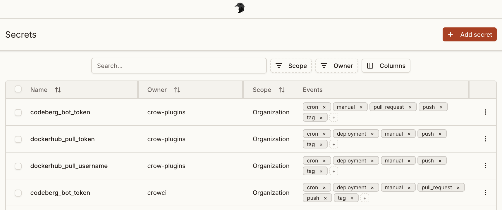

Crow CI provides an integrated secret store.
These secrets can be passed securely to individual steps using the `from_secret` keyword.



## Levels

Three different levels of secrets are available:

1. **Repository secrets**: Available to all workflows of a repository.
1. **Organization secrets**: Available to all workflows of an organization.
1. **Global secrets**: Global secret are available to all pipelines of the entire Crow CI instance.
    Can only be set by instance administrators.

:::note
If a secret is defined at multiple levels, repository secrets take precedence over organization secrets, which in turn override global secrets, following this hierarchy.
:::

:::tip
In addition to native secrets, Crow CI supports [external secret store integrations](/dev/usage/integrations/) such as HashiCorp Vault and OpenBao.
These allow you to fetch secrets directly from your existing secret management infrastructure during pipeline execution.
:::

:::note
Crow CI automatically masks both native secrets and external secrets (from integrations like Vault) in the log output.
:::

## Defining secrets

Secrets are defined using the `from_secret:` keyword in the `environment:` section:

```yaml
steps:
  - name: 'step name'
    image: registry/repo/image:tag
    commands:
      - echo "The secret is $TOKEN_ENV"
    environment:
      TOKEN_ENV:
        from_secret: secret_token
```

Secrets names can be uppercase or lowercase.
The same applies to the environment variables they are assigned to.

Secrets can also be used for `settings:` in plugins:

```yaml
steps:
  - name: 'step name'
    image: registry/repo/image:tag
    commands:
      - echo "The secret is $TOKEN_ENV"
    settings:
      TOKEN:
        from_secret: secret_token
```

:::caution
Parameter expressions like secrets undergo pre-processing, meaning they are evaluated before the workflow starts.
If secrets are to be used in commands directly, they must be properly escaped (using `$$`) to ensure correct handling.

```yaml
steps:
  - name: docker
    image: docker
    commands:
      - echo $${TOKEN_ENV}
    environment:
      TOKEN_ENV:
        from_secret: secret_token
```

:::

## Filtering

To prevent secrets from potential abuse in arbitrary steps, they can be limited to specific plugins in the repository settings.

Plugins offer the advantage of not being able to execute arbitrary commands (in contrast to normal steps), and by this inherently prohibit the possibility of exposing secrets in any kind of way.

:::caution
Filtering only works for plugins, not for arbitrary images.
Applying it to the latter would not make sense as malicious actors could simply use the specified image to exploit the secret.
:::

## Adding secrets via CLI

Secrets can also be added via the CLI.

By default, secrets will be available without any restriction:

```sh
crow-cli repo secret add \
  --repository octocat/hello-world \
  --name my_secret \
  --value <value>
```

Limit it to a specific plugin:

```sh
crow-cli secret add \
  --repository octocat/hello-world \
  --image woodpeckerci/plugin-s3 \
  --name aws_access_key_id \
  --value <value>
```

The `--image` can also be passed multiple times.

Limit to specific events:

```sh
crow-cli repo secret add \
  --repository octocat/hello-world \
  --image woodpeckerci/plugin-s3 \
  --event pull_request \
  --event push \
  --event tag \
  --name aws_access_key_id \
  --value <value>
```

Secret can also be loaded from a file on disk.
This can be useful for multi-line secrets like SSH keys:

```sh
crow-cli repo secret add \
  --repository octocat/hello-world \
  --name ssh_key \
  --value @/root/ssh/id_rsa
```
