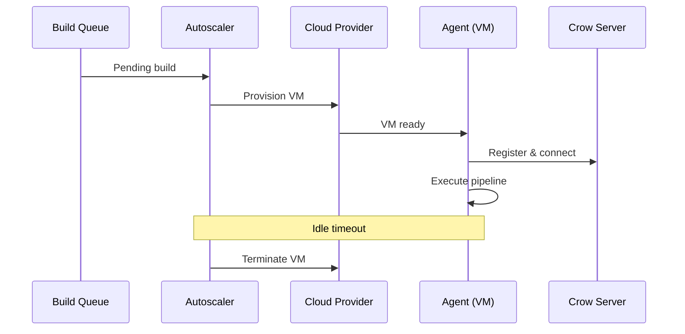

import { Steps } from '@astrojs/starlight/components';

The [Crow CI Autoscaler](https://codefloe.com/crowci/autoscaler) dynamically provisions cloud servers to execute pipelines, then terminates them when idle.



## Supported Providers

| Provider | Configuration Reference |
| -------- | ----------------------- |
| AWS | [flags.go](https://codefloe.com/crowci/autoscaler/src/branch/main/providers/aws/flags.go) |
| Hetzner Cloud | [flags.go](https://codefloe.com/crowci/autoscaler/src/branch/main/providers/hetzner/flags.go) |
| Linode | [flags.go](https://codefloe.com/crowci/autoscaler/src/branch/main/providers/linode/flags.go) |
| Scaleway | [flags.go](https://codefloe.com/crowci/autoscaler/src/branch/main/providers/scaleway/flags.go) |
| Vultr | [flags.go](https://codefloe.com/crowci/autoscaler/src/branch/main/providers/vultr/flags.go) |

Additional providers with a Go SDK can be added — contributions welcome!

## Setup

<Steps>

1. **Deploy alongside the server** — the autoscaler listens for build triggers

2. **Configure server connection** — provide server address and authentication tokens

3. **Configure scaling limits** — set min/max agents and workflows per agent

4. **Configure gRPC** — remote agents need secure gRPC connection to server

5. **Configure cloud provider** — set provider credentials and instance settings

</Steps>

## Complete Example

```yaml
# docker-compose.yaml
services:
  crow-autoscaler:
    image: codefloe.com/crowci/crow-autoscaler:<version>
    restart: always
    depends_on:
      - crow-server
    environment:
      # Server connection
      - CROW_SERVER=crow-server:9000
      - CROW_TOKEN=${CROW_TOKEN}                    # Admin API token
      - CROW_AUTOSCALER_TOKEN=${CROW_AUTOSCALER_TOKEN}

      # Scaling limits
      - CROW_MIN_AGENTS=0
      - CROW_MAX_AGENTS=2
      - CROW_WORKFLOWS_PER_AGENT=5

      # gRPC (for remote agents)
      - CROW_GRPC_ADDR=grpc.crow.example.com
      - CROW_GRPC_SECURE=true

      # Timeouts
      - CROW_AGENT_IDLE_TIMEOUT=10m
      - CROW_AGENT_SERVER_CONNECTION_TIMEOUT=10m

      # Cloud provider (Hetzner example)
      - CROW_PROVIDER=hetznercloud
      - CROW_HETZNERCLOUD_API_TOKEN=${HETZNER_TOKEN}
      - CROW_HETZNERCLOUD_LOCATION=fsn1
      - CROW_HETZNERCLOUD_SERVER_TYPE=cax41
      - CROW_HETZNERCLOUD_IMAGE=ubuntu-24.04
      - CROW_HETZNERCLOUD_NETWORKS=my-network
      - CROW_HETZNERCLOUD_SSH_KEYS=my-key
      - CROW_HETZNERCLOUD_FIREWALLS=my-firewall

      # Optional: agent environment
      - CROW_AGENT_ENV=CROW_LOG_LEVEL=debug,CROW_HEALTHCHECK=false
```

## Configuration Reference

### Server Connection

| Variable | Description |
| -------- | ----------- |
| `CROW_SERVER` | Server address (internal or public URL) |
| `CROW_TOKEN` | Admin API token for agent management |
| `CROW_AUTOSCALER_TOKEN` | Registration token for autoscaler |

### Scaling

| Variable | Default | Description |
| -------- | ------- | ----------- |
| `CROW_MIN_AGENTS` | `0` | Minimum agents always running |
| `CROW_MAX_AGENTS` | `1` | Maximum concurrent agents |
| `CROW_WORKFLOWS_PER_AGENT` | `1` | Parallel workflows per agent |

:::tip
Monitor resource usage during initial builds to tune `CROW_WORKFLOWS_PER_AGENT`. The optimal value depends on your instance type and workflow requirements.
:::

### Timeouts

| Variable | Default | Description |
| -------- | ------- | ----------- |
| `CROW_AGENT_IDLE_TIMEOUT` | `10m` | Time before idle agent is terminated |
| `CROW_AGENT_SERVER_CONNECTION_TIMEOUT` | `10m` | Max time without server connection |

:::tip
Match idle timeout to your provider's billing cycle. If billed hourly, consider keeping agents alive longer to handle subsequent builds.
:::

### gRPC Connection

Remote agents require secure gRPC to connect back to the server.

| Variable | Description |
| -------- | ----------- |
| `CROW_GRPC_ADDR` | Public gRPC address (no protocol prefix) |
| `CROW_GRPC_SECURE` | Set `true` for TLS connection |

### Agent Environment

Pass arbitrary environment variables to spawned agents:

```yaml
CROW_AGENT_ENV=CROW_LOG_LEVEL=debug,CROW_HEALTHCHECK=false
```

## gRPC Proxy Setup

Remote agents need a TLS-secured gRPC endpoint. Configure your reverse proxy to forward to the server's gRPC port (default: 9000).

:::note
Use Let's Encrypt or similar for SSL certificates.
:::

### Nginx

```nginx
server {
    listen 443 ssl http2;
    server_name grpc.crow.example.com;

    ssl_certificate /etc/ssl/certs/crow.crt;
    ssl_certificate_key /etc/ssl/private/crow.key;

    location / {
        grpc_pass grpc://crow-server:9000;
    }
}
```

### Caddy

```txt
grpc.crow.example.com {
    reverse_proxy h2c://crow-server:9000
}
```

### Traefik

```yaml
http:
  routers:
    crow-grpc:
      rule: Host(`grpc.crow.example.com`)
      service: crow-server
      tls:
        certResolver: letsencrypt
  services:
    crow-server:
      loadBalancer:
        servers:
          - url: h2c://crow-server:9000
```

## Hybrid Setup

Combine static agents (always-on) with autoscaled agents (on-demand) for cost efficiency.

| Agent Type | Use Case |
| ---------- | -------- |
| Static | Fast, lightweight builds; always available |
| Autoscaled | Resource-intensive builds; cost-optimized |

**Example:** Run a small static agent alongside the server for quick jobs. The autoscaler provisions powerful VMs only when the static agent is at capacity.

Use labels to route workflows:

**Static agent configuration:**

```yaml
CROW_AGENT_LABELS=tier=standard
```

**Workflow targeting autoscaled agents (.crow.yaml):**

```yaml
labels:
  tier: heavy
```

The autoscaler checks for available agents before provisioning. If a static agent can handle the workload, no new VM is created.
