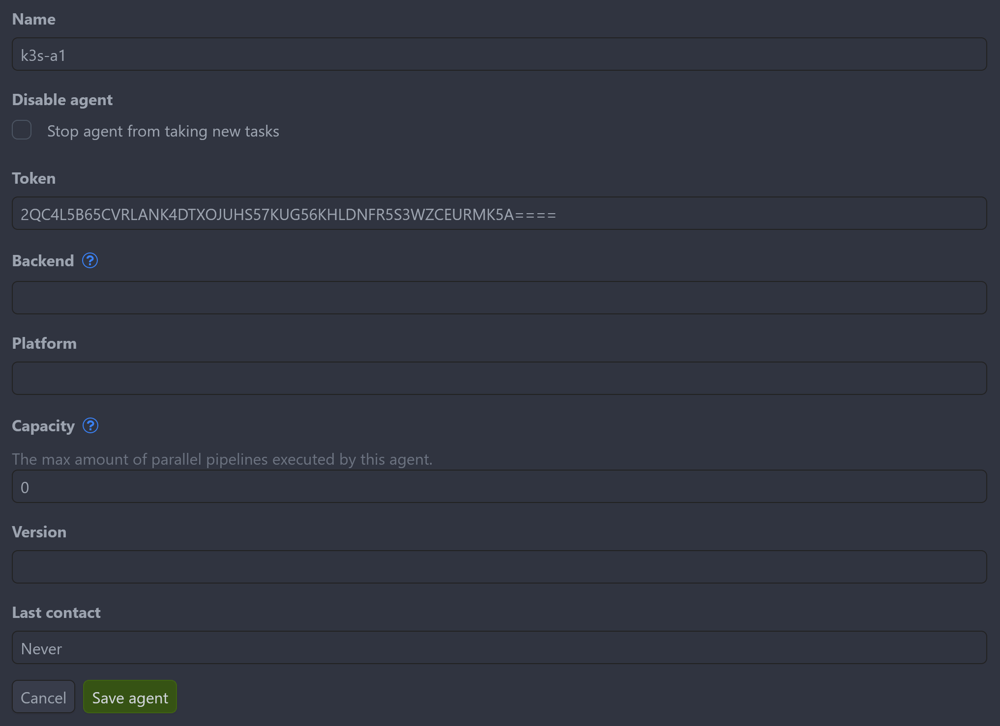

Crow CI consists of three components:

| Component | Required | Description |
| --- | --- | --- |
| **Server** | Yes | UI, API, webhook handling, pipeline parsing |
| **Agent** | Yes | Executes pipelines via Docker, Kubernetes, or local backend |
| **Autoscaler** | No | Spins up/down cloud VMs for pending builds |

## Installation Methods

| Method | Best For |
| --- | --- |
| [Docker Compose](/v4-5/installation/container/) | Single-server deployments |
| [Helm Chart](/v4-5/installation/helm/) | Kubernetes clusters |
| [Binary](/v4-5/installation/binary/) | Custom deployments |
| [Ansible](/v4-5/installation/ansible/) | Automated provisioning |

## Database

Crow uses SQLite by default. For production, PostgreSQL or MariaDB is recommended.[^1]

:::note
Database deployment is not covered here. Use existing guides or managed cloud services. You can start with SQLite and migrate later.
:::

## Container Images

Images are published to the Codeberg Container Registry:

- [crow-server](https://codefloe.com/crowci/-/packages/container/crow-server)
- [crow-agent](https://codefloe.com/crowci/-/packages/container/crow-agent)
- [crow-cli](https://codefloe.com/crowci/-/packages/container/crow-cli)
- [crow-autoscaler](https://codefloe.com/crowci/-/packages/container/crow-autoscaler)

### Image Tags

| Tag | Description |
| --- | --- |
| `vX.Y.Z` | SemVer release (scratch image) |
| `vX.Y.Z-alpine` | SemVer release (Alpine, rootless) |
| `vX`, `vX.Y` | Rolling major/minor version |
| `dev` | Latest from `main` branch |
| `pull_<ID>` | PR preview builds |

:::note
No `latest` tag exists to prevent accidental major version upgrades.
:::

## Agent Authentication

Agents authenticate with the server using tokens via `CROW_AGENT_SECRET`.

### System Token

Set the same `CROW_AGENT_SECRET` on both server and agent. On first connection:

1. Agent connects with system token
2. Server registers agent and returns unique ID
3. Agent stores ID in `CROW_AGENT_CONFIG_FILE`
4. Subsequent connections use stored ID

:::tip
Persist `CROW_AGENT_CONFIG_FILE` to prevent duplicate agent registrations on container restarts.
:::

### Agent Token

For multiple agents with different configurations, create tokens via **Settings → Agents → Add agent** or the API. Each agent uses its assigned token in `CROW_AGENT_SECRET`.



## Remote Agents

Agents can run on separate machines from the server.

### Internal Network

Connect using private IP addresses:

```yaml
CROW_SERVER: <private-ip>:8000
CROW_GRPC_ADDR: <private-ip>:9000
CROW_AGENT_SECRET: <token>
```

### Public Network

Requires TLS for secure GRPC connection:

```yaml
CROW_SERVER: crow.mydomain.com
CROW_GRPC_ADDR: grpc.crow.mydomain.com
CROW_GRPC_SECURE: "true"
CROW_AGENT_SECRET: <token>
```

Requirements:
- Subdomain for GRPC service
- Valid SSL certificate
- TLS-terminating proxy

:::caution
Do not prefix `CROW_SERVER` with `https://`.
:::

See [Reverse Proxy Setup](/v4-5/installation/proxy/) for ingress configuration examples.

[^1]: Pipeline logs are stored in the database. External log storage is planned.
