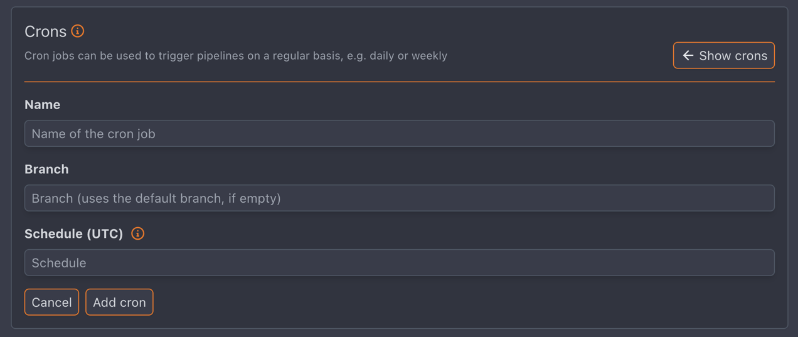

To configure CRON jobs, at least "push" access to the repository is required.

To create a new CRON job, add the event filter:

```yaml
when:
  event: cron
  # without setting a name, the pipeline is run for every 'cron' event
  cron: "name of the cron job"

steps:
[...]
```


:::note
CRON project configuration
:::

The supported schedule syntax is described in the [gdgvda/cron documentation](https://pkg.go.dev/github.com/gdgvda/cron#hdr-CRON_Expression_Format).
The [crontab generator](https://it-tools.tech/crontab-generator) is a helpful tool to get started with CRON expressions.

Common shortcuts:

- `@every 5m`: every 5 minutes
- `@daily`: every day at midnight
- `30 * * * *`: every hour at 30 minutes
- `@hourly`: every hour at the beginning of the hour
- `@weekly`: every week on Sunday at midnight
- `@monthly`: every month on the first day at midnight
