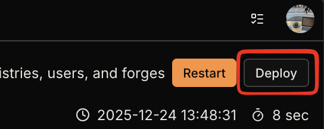
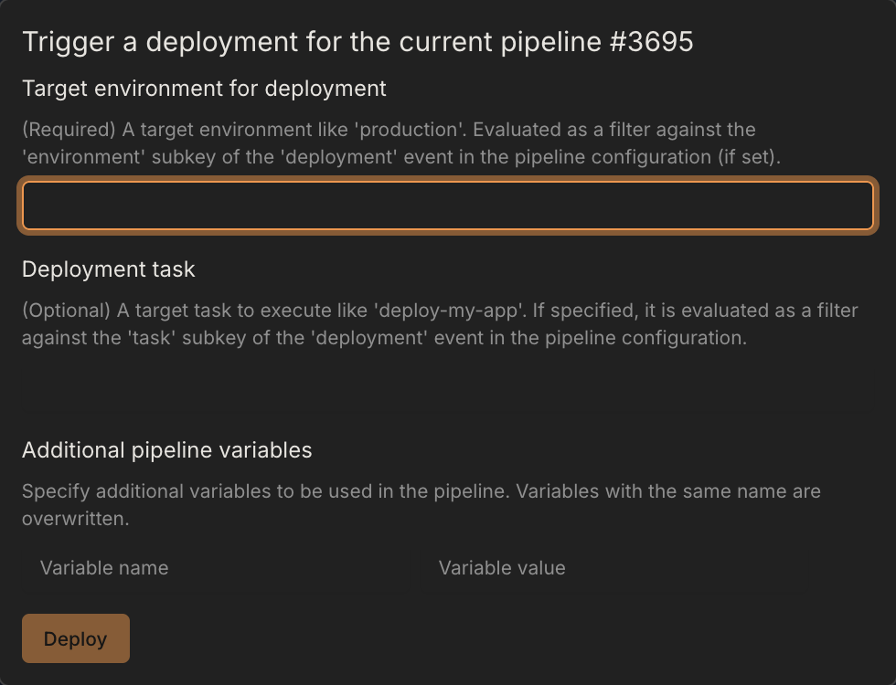

import { Steps } from '@astrojs/starlight/components';

Deployments are manually triggered pipeline runs for deploying successful builds to specific environments like staging or production.

## Prerequisites

Deployments must be enabled in the repository settings:

<Steps>

1. **Open repository settings**

    Go to **Repository Settings** → **General**

2. **Enable deployments**

    Check the **Deployments** option

</Steps>

Once enabled, a **Deploy** button appears on finished pipelines.



## Triggering a Deployment

Click the **Deploy** button to open the deployment dialog:



| Field | Required | Description |
| --- | --- | --- |
| Environment | Yes | Target environment (e.g., `production`, `staging`) |
| Task | No | Secondary filter to narrow down deployment jobs |

## Filtering Deployments in Workflows

Use the `deployment` event in your workflow's `when` block to control which steps run during deployments.

### Basic Environment Filter

```yaml
when:
  event: deployment
  environment: production
```

### Environment with Task Filter

```yaml
when:
  event: deployment
  environment: production
  task: migrate-db
```

### Glob Patterns

Both `environment` and `task` support glob patterns:

```yaml
when:
  event: deployment
  environment: prod-*
  task: deploy-*
```

### Include/Exclude Syntax

For complex filtering, use include/exclude lists:

```yaml
when:
  event: deployment
  environment:
    include: [production, staging]
    exclude: [production-test]
```
