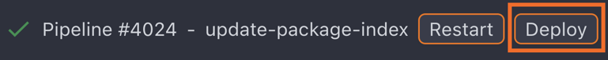
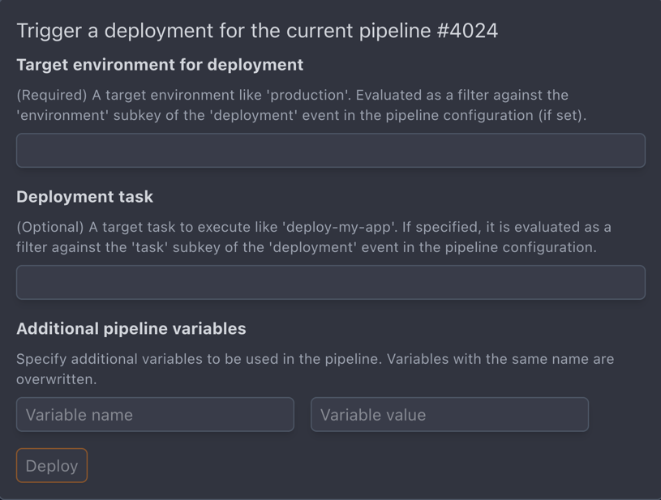

---
hide:
  - toc
---

<!-- markdownlint-disable MD041 -->

"Deployments" in Crow are _manually_ triggered events on top of _finished_ pipelines.
They relate to the idea to "deploy" successful builds to a specific environment (e.g. "production").

/// important
Deployments are not enabled by default.
They must be explicitly allowed in the repo settings within the "General" section.
///

If enabled, the "Deploy" button is shown.


/// caption
Deploy Button
///

When clicked, a popup opens with various options.
It requires specifying a target environment.
The input can be arbitrary (as long as no `environment` sub-filter is set in the YAML).
Behind the scenes, a pipeline is started and possibly filtered against the specified environment.
For example:

```yaml
when:
  event: deployment
  environment: production
```

In addition, an optional secondary filter can be set via the "Deployment task" option.
This allows to further narrow down deployment jobs within a specific environment.
In YAML config, this would be specified as:

```yaml
when:
  event: deployment
  environment: production
  task: job1
```

Both `environment` and `task` support glob patterns and include/exclude syntax:

```yaml
when:
  event: deployment
  environment: prod-*
  task: deploy-*
```

```yaml
when:
  event: deployment
  environment:
    include: [production, staging]
    exclude: [production-test]
```


/// caption
Deployment Popup
///
